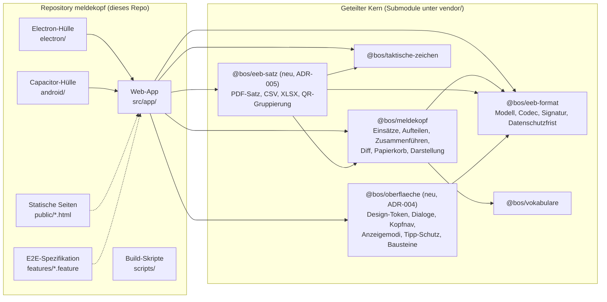
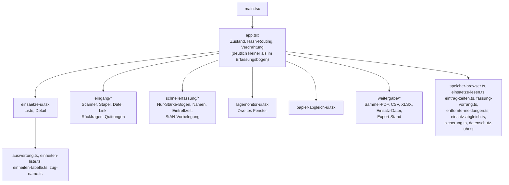
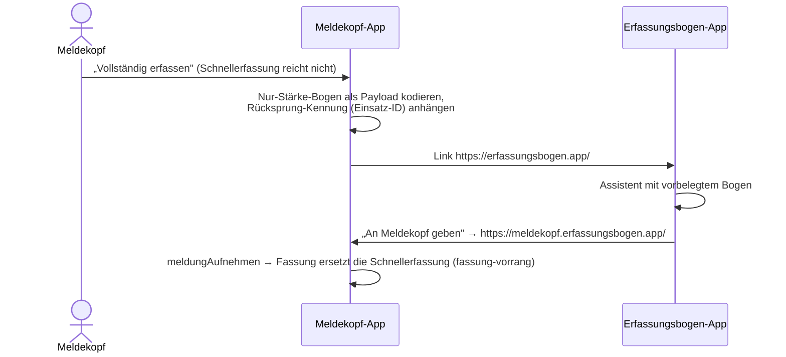

# Architektur der Meldekopf-App (Arc42)

Stand: 2026-10-25, Phase 0 (Gerüst) umgesetzt. Dieses Dokument beschreibt den
**Soll-Stand** und wird mit dem Code zum Ist-Stand; wo ein Abschnitt den
Ist-Stand der Phase 0 nennt, ist er als solcher markiert. Wo es konkrete Zahlen nennt, stammen sie
aus dem Erfassungsbogen (Commit `c789947`, Zweig `claude/lucid-faraday-r4h32d`)
und wurden dort nachgemessen; sie sind als Ausgangsgröße zu lesen, nicht als
Zusage. Die Arc42-Doku des Erfassungsbogens
(`docs/arc42-architektur.md` dort) bleibt die ausführlichere Referenz für
alles, was übernommen wird; hier steht, was anders ist.

## 1. Einführung und Ziele

### 1.1 Aufgabenstellung

Die Meldekopf-App sammelt die Erfassungsbögen eintreffender Einheiten unter
einem Einsatz, zählt Stärke und Sofortbedarf laufend zusammen und gibt die
Lage geschlossen an die nächste Führungsstelle weiter. Sie ist das mittlere
Glied der Produktfamilie:

| App | Rolle |
| --- | --- |
| Erfassungsbogen | Eine Einheit erzeugt ihren Bogen (QR, Link, Datei, PDF). |
| **Meldekopf** | Ein Gerät sammelt viele Bögen und gibt eine Lage weiter (Sammel-PDF, CSV, XLSX, Einsatz-Datei). |
| S1-Control | Der Stab liest die Einsatz-Datei und führt die Lage über Tage, Geräte und Sachgebiete. |

Die Funktionen existieren heute als Einsatz-Sammlung **innerhalb** des
Erfassungsbogens. Sie werden herausgelöst, weil zwei Nutzergruppen mit
verschiedenen Aufgaben dort eine Oberfläche teilen und die Einheit laufend
Fragen beantwortet, die nur den Meldekopf betreffen. Der Funktionsumfang steht
in [funktionsumfang.md](funktionsumfang.md), der Weg der Übernahme in
[uebernahme-aus-erfassungsbogen.md](uebernahme-aus-erfassungsbogen.md).

### 1.2 Qualitätsziele

| Prio | Ziel | Konkret |
| --- | --- | --- |
| 1 | Offline-Fähigkeit | Jede Funktion ohne Netz, ohne Server, ohne Kopplung der Geräte. Nach dem ersten Laden läuft die PWA vollständig aus dem Service-Worker-Cache. |
| 2 | Feldtauglichkeit | Bedienbar bei Sonne, Nacht, Handschuhen, Zeitdruck; die Feldtauglichkeits-Ergebnisse des Erfassungsbogens (acht Audit-Runden) gehen vollständig mit. |
| 3 | Datensparsamkeit und Fristen | Nur was die Lage braucht; Datenschutzfrist 90 Tage, Papierkorb 30 Tage, Aufräumfrist 90 Tage; Lagemonitor ohne Personennamen. |
| 4 | Kompatibilität | Alle QR-Codes, Dateien und Sammlungen, die der Erfassungsbogen je erzeugt hat, bleiben lesbar (Schema ab Version 2, `eeb.einsaetze.v1`). |
| 5 | Nachvollziehbarkeit | Jede Handlung der Führungsstelle (Abrücken, Zug, Auftrag, Zeitkorrektur) als Vermerk mit Uhrzeit; nichts wird still überschrieben. |
| 6 | Wartbarkeit | Geteilter Kern in Submodulen, keine Kopie von Fachlogik; CI-Gates für Kern-Kopien und Bundle-Budget. |

### 1.3 Stakeholder

| Rolle | Erwartung |
| --- | --- |
| Meldekopf, Leitung Bereitstellungsraum, kleine Führungsstelle | Eintreffende Einheit in Sekunden (QR) oder Minuten (ohne Bogen) aufgenommen; Summen stimmen immer; Weitergabe enthält genau das Neue. |
| Einheit mit Erfassungsbogen | Ihr Bogen wird ohne Rückfragen gelesen; ihre Signatur wird geprüft und gegengezeichnet. |
| Stab mit S1-Control | Bekommt eine Einsatz-Datei, die er ohne Nacharbeit einliest. |
| Einsetzende Organisation (Datenschutz, IT-Sicherheit) | ISK und DSFA als Vorlage; Netzverbindungen nur die eine zur Reichweitenmessung. |
| Entwicklung (ein Entwickler, Claude Code) | Übernahme vor Neubau; Kern bleibt unberührt; Doku wandert mit dem Code. |

## 2. Randbedingungen

### 2.1 Technisch

- **Stack wie der Erfassungsbogen**, damit Build, Release, Härtung und
  Audit-Ergebnisse übernommen werden können: TypeScript, React 19, Vite 8,
  vite-plugin-pwa (Workbox), Vitest 4, Cucumber + Playwright, Electron 44 mit
  electron-updater, Capacitor 8, pdfmake 0.3, pako, @noble/ed25519, zxing-wasm
  und jsQR, Node 24. Versionsstände vom 2026-10-25; sie folgen dem
  Erfassungsbogen.
- **Geteilter Kern als Git-Submodule** unter `vendor/`: `@bos/eeb-format`,
  `@bos/meldekopf`, `@bos/vokabulare`, `@bos/taktische-zeichen`. Gepinnte
  Commits, Vite-Alias auf `vendor/*/src/*.ts`, modulgenaue Importe. Die sechs
  Aufnahmeregeln aus ADR-003 des Erfassungsbogens gelten unverändert
  (Kapitel 9).
- **Kein Backend.** `localStorage` als einzige Ablage, hineingereicht in den
  Kern (`speicherhuelleSetzen`).
- **GitHub Pages** liefert die PWA unter meldekopf.erfassungsbogen.app; **GitHub Releases**
  tragen Installer, APK und Update-Metadaten. Beides ist je Repository, daher
  ein eigenes Repository (ADR-002).
- **Content-Security-Policy** als `<meta>` im Build wie im Erfassungsbogen:
  `default-src 'self' file:`, `object-src 'none'`, `connect-src` und `img-src`
  zusätzlich nur der GoatCounter-Host.

### 2.2 Organisatorisch

- Ein Entwickler, Entwicklung mit Claude Code; Deutsch in Code, Doku, Commits.
- Lizenz EUPL-1.2; taktische Zeichen CC BY 4.0.
- Jeder Push auf `main` baut ein Release mit Datums-Version (Muster
  `release.yml` des Erfassungsbogens); CI auf allen anderen Zweigen.
- Begleitdokumente (dieses, Funktionsumfang, Übernahme, später ISK und DSFA)
  werden im selben Arbeitsschritt wie der Code nachgezogen (`CLAUDE.md`).

### 2.3 Konventionen

- Dateinamen und Bezeichner deutsch, Kebab-Case für Dateien
  (`einsaetze-ui.tsx`), Kopfkommentar je Datei mit Zweck und, bei
  übernommenen Dateien, Herkunft im Erfassungsbogen.
- `localStorage`-Schlüssel mit Präfix `eeb.` und Versionssuffix (`.v1`);
  dieselben Schlüssel wie im Erfassungsbogen für dieselben Daten (ADR-007).
- Keine Systemdialoge, kein Tailwind, kein Router-Framework, kein Redux
  (ADR-002, ADR-007 des Erfassungsbogens).

## 3. Kontextabgrenzung

### 3.1 Fachlicher Kontext

```mermaid
flowchart LR
  Einheit["Einheit<br/>(Erfassungsbogen-App oder Papier)"]
  MK(("Meldekopf-App<br/>(ein Gerät, offline)"))
  TV["Fernseher am Gerät<br/>(Lagemonitor)"]
  Papier["Papier: Sammel-PDF,<br/>Lageblatt, Blanko"]
  Stab["S1-Control<br/>(Stab)"]
  MK2["Zweites Meldekopf-Gerät<br/>(Ablösung)"]
  Oldenburg["Einheitenliste Oldenburg<br/>(Excel der Führungsstelle)"]

  Einheit -->|"QR-Code, Link, Datei, PDF,<br/>Foto, Handscanner"| MK
  MK -->|"„Vollständig erfassen"<br/>Link mit Payload"| Einheit
  MK -->|"zweites Fenster"| TV
  MK -->|"Sammel-PDF, Lageblatt"| Papier
  Papier -->|"Scan + Lage vom Papier abgleichen"| MK
  MK -->|"Einsatz-Datei, CSV"| Stab
  MK <-->|"Einsatz-Datei, Sammel-PDF"| MK2
  MK -->|"XLSX"| Oldenburg
```

| Partner | Schnittstelle | Beschreibung |
| --- | --- | --- |
| Einheit mit Erfassungsbogen | QR (`EEB2`/`EEB2C`, Base41, segmentiert), Link `https://meldekopf.erfassungsbogen.app/#<Payload>`, JSON-Datei, PDF mit QR | Eingang in die Sammlung; Signatur wird geprüft und gegengezeichnet. |
| Einheit ohne Bogen | Bedienoberfläche (Schnellerfassung) | Nur Stärke, Führungskraft, Fahrzeuge; für mehr wird der Erfassungsbogen per Link geöffnet (ADR-006). |
| Erfassungsbogen-App | Link in beide Richtungen | Gleicher Payload wie der QR; von dort kommt „An Meldekopf geben", von hier „Vollständig erfassen". |
| S1-Control | Einsatz-Datei (JSON-Umschlag), CSV | Leser `einsaetzeAusJson` liegt im Kern; der Umschlag trägt Export-Stände und Lage-Angaben. |
| Zweites Meldekopf-Gerät | Einsatz-Datei, Sammel-PDF | Ablösung und Rückimport mit Abgleich je Feld (`einsatz-abgleich`). |
| Papier | Sammel-PDF, Lageblatt, Blanko | Referenzformat und Rückfallebene nach Geräteausfall. |
| USB-Handscanner | Tastatur-Emulation | Wie im Erfassungsbogen. |
| Excel-Vorlage „Oldenburg" | XLSX, 38 Spalten | Fest vorgegebenes Format einer Führungsstelle. |

### 3.2 Technischer Kontext

| System | Richtung | Zweck | Protokoll |
| --- | --- | --- | --- |
| GitHub Pages (meldekopf.erfassungsbogen.app) | eingehend, einmalig | Auslieferung der PWA; danach offline | HTTPS, statische Dateien |
| GoatCounter (`meldekopf.goatcounter.com`, eigene Site dieser App; Host in `src/app/adressen.ts`) | ausgehend | Cookielose Reichweitenmessung, ein Treffer je Kaltstart; einziger Fremd-Host in der CSP. Bewusst ohne das offizielle `count.js` von `gc.zgo.at` (wie im Erfassungsbogen): `statistik.ts` baut den Treffer selbst gegen dieselbe Zähl-URL `/count`, sonst wäre `gc.zgo.at` ein zweiter Fremd-Host und das Skript scheiterte unter `file://` und `capacitor://`. | HTTPS `sendBeacon` / Bild |
| GitHub Releases | ein-/ausgehend | Installer, APK, `latest*.yml` für electron-updater | HTTPS |
| Capacitor-Plugins | intern | Barcode-Scanner, Dateisystem, Teilen, App-Links | Bridge |
| Zweiter Bildschirm | intern | Lagemonitor als zweites Fenster derselben Herkunft, liest denselben `localStorage` | `window.open`, `storage`-Ereignis |

Es gibt **kein Backend, keine Datenbank, keine Nutzerkonten.** Jede neue
Netzverbindung ist eine Änderung an diesem Kapitel, an der CSP und an der
DSFA.

## 4. Lösungsstrategie

1. **Reines Client-System**, wie der Erfassungsbogen (dort Kap. 4.1).
2. **Eine Web-Codebasis, drei Hüllen**: Browser/PWA, Electron, Capacitor.
3. **Geteilter Kern** unverändert übernehmen; was beide Apps brauchen und
   keine Oberfläche ist, wandert zusätzlich in den Kern (ADR-005); was beide
   brauchen und Oberfläche ist, in einen Oberflächen-Baustein mit eigenen
   Regeln (ADR-004).
4. **Übernahme statt Neubau**: Module der Einsatz-Sammlung kommen mit ihren
   Tests, Kopfkommentaren und Audit-Begründungen; Umbenennungen nur, wo der
   Name den Erfassungsbogen voraussetzt.
5. **Kein Assistent in dieser App** (ADR-006): Schnellerfassung ja, der
   vollständige Bogen per Link im Erfassungsbogen.
6. **Gleiche Speicherschlüssel** wie der Erfassungsbogen (ADR-007), damit
   Datensicherung und Einsatz-Datei ohne Umbau hin- und herwandern.
7. **Harte Grenze zu S1-Control** (ADR-008): ein Gerät, offline, eine
   Weitergabe.

## 5. Bausteinsicht

### 5.1 Gesamtsystem (Level 1)



| Baustein | Verantwortung | Herkunft |
| --- | --- | --- |
| Web-App (`src/app/`) | Einsatzliste, Einsatzansicht, Eingänge, Schnellerfassung, Lagemonitor, Papier-Abgleich, Exporte, Persistenz-Anbindung, Plattform. | Erfassungsbogen `src/app/`, Meldekopf-Anteil (rund 14.700 Zeilen Produktivcode, siehe Übernahme-Doku) |
| `@bos/eeb-format` | Datenmodell (`SCHEMA_VERSION` 9), Codec, Signatur, Datenschutzfrist. | vorhanden |
| `@bos/meldekopf` | Einsatz-Sammlung als reine Logik: Revisionen, Dedupe, Fristen, Aufteilen, Zusammenführen, Diff, Papierkorb, Text-Darstellung. | vorhanden (3.167 Zeilen) |
| `@bos/vokabulare`, `@bos/taktische-zeichen` | Nachschlagetabellen, Zeichenauflösung. | vorhanden |
| `@bos/eeb-satz` (<https://github.com/wattnpapa/bos-eeb-satz>) | Was beide Apps ausgeben und keine Oberfläche ist: pdfmake-Dokumentdefinition (Einzel- und Sammel-PDF, Lageblatt), CSV-Schreiber, XLSX-Schreiber, Oldenburg-Spalten, QR-Gruppierung mehrteiliger Bögen, PDF-Bild-Leser. | neu, aus `pdf-dokument.ts` (2.258), `bogen-csv.ts` (423), `einsatz-csv.ts` (290), `oldenburg-xlsx.ts` (615), `xlsx.ts` (319), `csv.ts` (51), `qr-boegen.ts` (48), `pdf-bilder.ts`, `pdf-stroeme.ts`, `pdf-qr.ts` |
| `@bos/oberflaeche` (<https://github.com/wattnpapa/bos-oberflaeche>) | Was beide Apps zeigen: Design-Token (CSS), Dialogschicht, Modal-Overlay, Kopfnavigation, Anzeigemodi, Organisationsfarben, Tipp-Schutz, Schriftstufen, Tastatur-Erkennung, Quittungen, Feld-Bausteine. **Darf React und DOM**, aber keine Fachlogik und keine Persistenz außer den eigenen Anzeige-Schlüsseln. | neu, aus `dialoge.tsx` (487), `modal-overlay.ts` (259), `kopfnav.ts`/`kopfnav-ui.tsx` (338), `anzeige-modus.ts`/`anzeige-schalter.tsx` (383), `org-farben.ts` (358), `tipp-schutz.ts` (288), `schrift-stufe.ts`, `tastatur.ts`, `daumen-quittung.tsx`, `schritte/bausteine.tsx` (742, Auswahl) |
| Electron-Hülle | Fenster, Auto-Update, Berechtigungen, Lagemonitor-Fenster. | `electron/main.js` |
| Capacitor-Hülle | Android-Projekt; iOS folgt. | `android/`, `capacitor.config.json` |
| Statische Seiten | Anleitung, Datenschutz, Impressum; weniger als beim Erfassungsbogen (keine Organisations-Landingpages). | `public/` (Auswahl) |

### 5.2 Web-App (Level 2)



Die Unterverzeichnisse `eingang/`, `schnellerfassung/`, `weitergabe/` sind
neu; im Erfassungsbogen liegt alles flach in `src/app/`. Sie gliedern die
übernommenen Dateien nach dem Ablauf am Meldekopf (Eingang, Erfassung, Lage,
Weitergabe), ohne Dateien zu zerschneiden.

**Ist-Stand Phase 0 (2026-10-25):** `src/app/` enthält `main.tsx`, `app.tsx`
(nur Startseite), `start-inhalt.ts`, `adressen.ts` (Domain und Zähl-Host an
einer Stelle), `fusszeile.tsx` (gekürzt), `nativ.ts` und `aktualisierung.tsx`
(je auf den Web-Teil gekürzt), `statistik.ts`, `werkzeuge.ts` — und als
**Kopien aus dem Erfassungsbogen mit Herkunft im Kopfkommentar**, die in
Phase 1 nach `@bos/oberflaeche` wandern: `dialoge.tsx`, `modal-overlay.ts`,
`anzeige-modus.ts`, `anzeige-schalter.tsx`, `tipp-schutz.ts`, `tastatur.ts`,
`schrift-stufe.ts`, `kopfnav.ts`, `kopfnav-ui.tsx`, `seiten-kopf.tsx`, dazu
der Token-Block in `index.html`. Alle mit ihren Tests.

### 5.3 Zuordnung Anforderung → Baustein

| Anforderung | Bausteine |
| --- | --- |
| Bogen aufnehmen | `eingang/*`, `@bos/eeb-format/codec`, `@bos/meldekopf/einsaetze`, `eintrag-zeiten.ts` |
| Einheit ohne Bogen erfassen | `schnellerfassung/*`, `@bos/vokabulare`, `@bos/oberflaeche` (Bausteine) |
| Lage lesen | `einsaetze-ui.tsx`, `auswertung.ts`, `einheiten-liste.ts`, `einheiten-tabelle.ts` |
| Lagemonitor | `lagemonitor-ui.tsx`, `lagemonitor.ts`, `lage-angaben.ts` |
| Weitergabe | `weitergabe/*`, `@bos/eeb-satz`, `export-stand.ts`, `einsatz-transport.ts` |
| Ablösung und Rückimport | `einsatz-abgleich.ts`, `entfernte-meldungen.ts` |
| Papier-Rückfallebene | `papier-abgleich-ui.tsx`, `papier-abgleich-entwurf.ts` |
| Fristen | `@bos/eeb-format/datenschutzfrist`, `datenschutz-uhr.ts`, `@bos/meldekopf` (Papierkorb, Aufräumfrist) |

## 6. Laufzeitsicht

### 6.1 Bogen aufnehmen

Unverändert aus dem Erfassungsbogen (dort Kap. 6.3): Eingang → Fingerabdruck
→ Dedupe → Revision oder neuer Eintrag → Diff → Persistieren → Summen. Alle
Eingänge laufen über `meldungAufnehmen` (`eintrag-zeiten.ts`); eine neue
Fassung erbt Eintreffzeit, Auftrag, Zug und Teil-Etikett der Vorgängerin.

### 6.2 Vollständiger Bogen über den Erfassungsbogen



Offen (Gerätetest): ob der Wechsel zwischen zwei installierten PWAs auf iOS
ohne Netz sauber läuft. Auf Android und Desktop öffnet der Link die
installierte App oder den Browser-Tab; beide bedienen den Service Worker.
Rückfallebene ist immer der QR-Code auf dem Bildschirm des anderen Geräts.

### 6.3 Weitergabe an S1-Control

Einsatz-Datei schreiben (`einsatzDateiInhalt`: Sammlung, Export-Stände,
Lage-Angaben) → Export-Stand je Format vermerken → Datei teilen (nativ) oder
speichern. S1-Control liest mit `einsaetzeAusJson` aus dem Kern. Ob
S1-Control den Umschlag mit Ständen und Lage-Angaben schon versteht, ist zu
prüfen (Kapitel 11).

### 6.4 Lagemonitor

Zweites Fenster derselben Herkunft (`?lagemonitor=<Einsatz-ID>`), liest
`eeb.einsaetze.v1` und die Lage-Schlüssel, hört auf `storage`, hält den
Bildschirm wach (Wake Lock, wo verfügbar). In Electron öffnet der Hauptprozess
dafür ein eigenes Fenster; die Berechtigungsregel lässt genau diese Adresse zu.

### 6.5 Offline-Start, Auto-Update

Wie im Erfassungsbogen (dort Kap. 6.4, 6.5): zweistufiger Vorrat (Kern vom
Service Worker, Zusatz nachgeladen), Update-Banner im Web, electron-updater
gegen die Releases dieses Repos.

## 7. Verteilungssicht

| Ziel | Weg | Anmerkung |
| --- | --- | --- |
| Web/PWA | GitHub Pages, Domain meldekopf.erfassungsbogen.app (Subdomain, CNAME im DNS von erfassungsbogen.app), `release.yml` Jobs `build-pages`/`deploy-pages` | Eigene Site je Repo ist der Grund für das eigene Repo (ADR-002). meldekopf.app war vergeben. Der Domainname steht genau einmal in `src/app/adressen.ts`; der Build schreibt daraus `dist/CNAME` und setzt `%DOMAIN%` in Canonical, Open Graph, robots.txt und Textseiten ein (Plugin `adressen` in `vite.config.ts`). Ein anderer Name ist eine Zeile dort plus DNS. Live, sobald `main` gebaut hat, Pages im Repo auf „GitHub Actions" steht und der DNS-Eintrag existiert. |
| Windows x64/arm64 | NSIS-Installer aus `electron-builder`, GitHub Releases | `appId` `de.meldekopf.app`, `productName` „Meldekopf", `publish.url` auf dieses Repo. |
| macOS | dmg/zip; Job zunächst still wie beim Erfassungsbogen | Signierung erst mit hinterlegten Secrets. |
| Linux | deb, pacman | |
| Android | Capacitor, APK im Release; Play Store später | Paket `de.meldekopf.app`, App-Links `meldekopf.erfassungsbogen.app` mit `assetlinks.json`. Job `build-android` in `release.yml` ist bis zur Übernahme von `android/` (Phase 5) stillgelegt (`if: false`) und aus `needs` des Release-Jobs genommen. |
| iOS | folgt dem Stand des Erfassungsbogens | AASA mit Team-ID, Associated Domains. |

Pipeline wie `release.yml` des Erfassungsbogens: `prepare` (Datums-Version,
Tag) → `check` (typecheck, lint, test, e2e, kern-kopien, bundle-budget, SBOM,
`npm audit`) → Plattform-Builds → Release → Pages.

## 8. Querschnittliche Konzepte

### 8.1 Oberfläche

Übernommen: Design-Token, „Amtlich"-Optik, Archivo im Bundle, Anzeigemodi
Hell/Dunkel/Feld/Nacht nur per Schalter. Eigenes Icon und eigene Grundfarbe
für den Meldekopf, damit auf einem Gerät mit beiden Apps klar ist, welche
offen ist.

**Kennfarbe: Petrol `#0f4c5c`** (Hover/Links `#126d78`, im Dunkel-Modus der
aufgehellte Ton `#8fd0d8`, nachts wie im Erfassungsbogen Bernstein). Gründe:
(1) Sie liegt im Farbkreis neben dem Dienstblau des Erfassungsbogens
(`#12275e`) — kühl, dunkel, dieselbe Familie — und ist auf einem Startbild-
schirm trotzdem auf den ersten Blick ein anderes Icon. (2) Sie kollidiert mit
keiner Kennfarbe einer Organisation aus `org-farben.ts` (Blau, Rot, Grün,
Oliv, Grau, Weiß), die später an taktischen Zeichen und Marken der Einheiten
steht. (3) Weiß darauf misst 9,5:1: Die Kopf-Töne des Erfassungsbogens
(Weiß, Zweitschrift, 7:1-Regel des Feld-Modus, R5-L3) tragen ohne Nach-
rechnen; der Feld-Modus muss den Balken nicht abdunkeln, der Dunkel-Modus
darf ihn behalten (R4-L2 betraf die hellen Rottöne). (4) Sie ist nicht das
Bernstein des Nacht-Modus. Die Töne sind mit derselben Kontrastrechnung
geprüft wie in `org-farben.ts` (Leuchtdichte nach WCAG 2.1).

**Abweichung vom Erfassungsbogen:** Der Kopfbalken des Meldekopfs trägt
immer die Meldekopf-Farbe, nicht die Kennfarbe einer Organisation. Die
Sammlung führt Einheiten vieler Organisationen; ein Balken, der je nach
offenem Bogen die Farbe wechselt, sagte hier nichts Wahres. Die Organisation
bleibt an taktischem Zeichen und Marke der Einheit erkennbar. `org-farben.ts`
kommt deshalb erst mit den Zeichen (Phase 2) und färbt dann nur Zeichen und
Marken, nicht die Seite.

**Icon:** dieselbe Formensprache wie der Erfassungsbogen (gerundetes Quadrat
mit Verlauf, weißer Bogen mit Eselsohr), aber als Stapel aus drei Bögen —
die Sammlung — und mit der Stärkezeile x / y / z // g als vier Kästchen,
das Gesamtfeld gefüllt. Master in `public/icon*.svg`, PNG-Fassungen über
`npm run icons` (`scripts/render-icons.mjs`).

### 8.2 Persistenz

Alle Nutzdaten im `localStorage`, Präfix `eeb.`. **Dieselben Schlüssel wie im
Erfassungsbogen** (ADR-007), damit Datensicherung und Einsatz-Datei ohne
Übersetzung funktionieren:

| Schlüssel | Inhalt | Herkunft |
| --- | --- | --- |
| `eeb.einsaetze.v1` | Alle Einsatz-Sammlungen (Kern) | `@bos/meldekopf` |
| `eeb.export-stand.v2` | Export-Stand je Einsatz und Format | `export-stand.ts` |
| `eeb.lageblatt-stand.v1`, `eeb.weitergabe-stand.v1`, `eeb.kenntnis-stand.v1` | Lageblatt-, Weitergabe-, Kenntnis-Stand | `export-stand.ts` |
| `eeb.entfernt.v1` | Vor Ort entfernte Meldungen je Sammlung | `entfernte-meldungen.ts` |
| `eeb.aufgeraeumt.v1` | Nachricht über automatisch gelöschte Sammlungen | `aufraeum-hinweis.ts` |
| `eeb.letzterEinsatz.v1` | Zuletzt offene Sammlung, 12 h | `app.tsx` |
| `eeb.lagebeginn.v1`, `eeb.lagefunkruf.v1`, `eeb.lagestufe.v1` | Lagemonitor: Beginn, Funkrufname, Helligkeit | `lagemonitor-*.ts` |
| `eeb.uhr.v1` | Zuletzt akzeptierter Uhrstand | `datenschutz-uhr.ts` |
| `eeb.entwurf.v1` | Angefangene Schnellerfassung (`Entwurf.fremd`) | `entwurf.ts`, reduziert |
| `eeb.anzeigemodus.v1` | Anzeigemodus | `anzeige-modus.ts` |
| `eeb.einsaetze-papierkorb.v1` | Papierkorb der Sammlungen (Kern) | `@bos/meldekopf/papierkorb` |
| `eeb.geraeteschluessel.v1`, `eeb.signieren.v1` | Privater Ed25519-Schlüssel zum Gegenzeichnen; Schalter, ob signiert wird | `geraete-schluessel.ts` |
| `eeb.sicherung.zuletzt.v1` | Zeitpunkt der letzten Datensicherung | `sicherung.ts` |
| `eeb.unlesbar.v1`, `eeb.entwurf.beschaedigt.v1`, `eeb.offline-zusatz.v1` | Beiseitegelegter unlesbarer Bestand; Stand des Offline-Vorrats | `unlesbar.ts`, `offline-bereit.ts` |
| `eeb.export-stand.v1` | Vorgängerfassung des Export-Stands, nur lesend für Bestände | `export-stand.ts` |
| `sessionStorage`: `eeb.papierabgleich.v1.<Einsatz>`, `eeb.wartet.fragment` | Zwischenstand Papier-Abgleich; wartender Link | `papier-abgleich-entwurf.ts`, `wartender-link.ts` |

**Nicht** übernommen: `eeb.musterung.v1`, `eeb.vorlagen.v1` (Vorlagen),
`eeb.entwurf.ersetzt.v1` (Rückholplatz des eigenen Bogens),
`eeb.absenderkarte.v1` als Sender (bleibt beim Erfassungsbogen; der Meldekopf
zeigt nur empfangene Absenderkarten an). `eeb.feldmodus.v1` ist der
Altschlüssel des Anzeigemodus und wird nur gelesen.

Fristen: Datenschutzfrist 90 Tage nach `stand` (Übungen ausgenommen),
Papierkorb 30 Tage, Aufräumfrist ruhender Sammlungen 90 Tage; alle über die
geprüfte Geräteuhr (`datenschutz-uhr.ts`), nie durch bloßen Zeitablauf nach
einem Uhrsprung.

### 8.3 Sicherheit und Datenschutz

Wie der Erfassungsbogen (dort Kap. 8.3): CSP ohne Fremdcode, Electron ohne
Node im Renderer, Berechtigungen nur Kamera, externe Links im Systembrowser,
Ed25519-Signaturkette. Die DSFA dieser App ist die schwere der beiden: Sie
hält fremde Personendaten vieler Einheiten über Tage. Die Vorlage des
Erfassungsbogens (`docs/datenschutz-folgenabschaetzung.md` dort) wird
übernommen und auf diese App zugeschnitten; dasselbe für das ISK. Beides
entsteht, sobald die App erstmals Nutzdaten hält (Phase 2 der Übernahme).

### 8.4 Kompatibilität

Schema-Evolution des Formats (ab Version 2 lesbar, additive Änderungen),
unbekannte Felder am `MeldeEintrag` werden vom Kern unverändert mitkopiert
(Grundlage der App-Zusätze `eingetroffenAm`, `abgerueckAm`, `notiz`,
`vermerke`, `ersetztDurch`, `vomPapier`). Sammlungen aus dem Erfassungsbogen
werden ohne Migration gelesen (ADR-007).

### 8.5 Tests

Vitest neben dem Code, Kern-Tests im Submodul; Cucumber + Playwright gegen den
produktiven Build (ADR-008 des Erfassungsbogens); Stilregel-Tests
(`stilregeln-*.test.ts`), soweit sie Meldekopf-Ansichten prüfen, gehen mit.
CI-Gates `kern-kopien` und `bundle-budget` mit eigenem Budget (Messung beim
ersten Build, dann festschreiben).

### 8.6 Abhängigkeiten

Laufzeit wie der Erfassungsbogen ohne das, was nur der Assistent braucht;
die Pakete kommen mit den Phasen, die sie brauchen (Phase 0: React,
`@capacitor/core` für die Plattform-Erkennung, `@fontsource-variable/archivo`,
`electron-updater`). SBOM und `npm audit` im CI. Submodul-Pins beim Start auf
den Stand des Erfassungsbogens vom 2026-10-25: `eeb-format` `eb58ad6`,
`bos-meldekopf` `59a986c`, `bos-vokabulare` `2f94a46`,
`bos-taktische-zeichen` `cb9c227`.

**Erste Messung (Phase 0, `scripts/bundle-budget.json`):** JavaScript gesamt
289.927 Byte, Startbündel 257.389 Byte, `dist/` 558.518 Byte; SBOM 1.025
Komponenten, davon 27 mit Laufzeit-Rolle. Zum Vergleich der Erfassungsbogen
am selben Tag: 5.500.797 / 1.198.089 Byte. Das Budget wird je Phase bewusst
angehoben (`npm run bundle-budget -- --setze`, Begründung im Commit).

**Werkzeugstand:** `npm install` braucht npm 11 (`npx npm@11 install`), npm 10
bricht an den `file:`-Abhängigkeiten der Submodule untereinander ab
(„Cannot read properties of null (reading 'edgesOut')"); mit Node 24
(`.nvmrc`) ist npm 11 dabei.

## 9. Architekturentscheidungen

### ADR-001: Eigene App statt Ansicht im Erfassungsbogen

- **Kontext:** Gut ein Drittel des Erfassungsbogens (rund 14.700 von 39.800
  Zeilen Produktivcode) ist Führungsstellen-Sicht; `app.tsx` (4.700 Zeilen)
  verdrahtet beide Welten; Startseite, Kopfnavigation und Eingangs-Flows
  stellen Einheiten Fragen, die nur den Meldekopf betreffen. Feedback von
  Nutzern bestätigt die Überladung.
- **Entscheidung:** Zwei Produkte. Der Erfassungsbogen behält nur, was eine
  Einheit braucht; der Meldekopf bekommt die Sammlung ganz.
- **Konsequenzen:** Zwei Apps auf einem Meldekopf-Gerät (Schnellerfassung
  hier, vollständiger Bogen dort); Übergang per Link. DSFA und ISK je App;
  die des Erfassungsbogens schrumpft, die des Meldekopfs trägt die fremden
  Personendaten. Der Erfassungsbogen baut seine Sammlung erst ab, wenn der
  Meldekopf fertig ist.

### ADR-002: Eigenes Repository

- **Kontext:** GitHub Pages liefert eine Site je Repo mit eigener Domain;
  GitHub Releases und electron-updater arbeiten je Repo; S1-Control ist
  bereits ein eigenes Repo; der Kern liegt in Submodulen.
- **Alternative:** Monorepo mit zwei Vite-Einstiegen und Deploy in ein reines
  Pages-Repo. Technisch möglich, aber zwei Apps mit getrennten
  Update-Kanälen in einem Release-Workflow und zwei Bundle-Budgets in einem
  Repo sind aufwendiger als die geteilte Oberfläche als Submodul.
- **Entscheidung:** Eigenes Repository `wattnpapa/meldekopf`; Gemeinsames
  über Submodule (ADR-004, ADR-005).
- **Konsequenz:** Jede Änderung an geteilten Bausteinen heißt Pin-Update in
  zwei bis drei Repos. Deshalb bleibt der Oberflächen-Baustein klein.

### ADR-003: Geteilter Kern als Submodule (übernommen)

Wörtlich die sechs Aufnahmeregeln und der Rückweg aus ADR-003 des
Erfassungsbogens: Aufnahme nur bei Bedarf beider Produkte; keine `node:`-,
DOM- oder React-Importe im Kern; keine Rückimporte; additive Änderungen;
Bundle-Budget; gepinnte Commits. Der Meldekopf ist jetzt das zweite Produkt,
das `@bos/meldekopf` in voller Breite nutzt; S1-Control das dritte.

### ADR-004: Oberflächen-Baustein `@bos/oberflaeche` mit eigenen Regeln

- **Kontext:** Dialogschicht, Anzeigemodi, Kopfnavigation, Tipp-Schutz,
  Schriftstufen, Quittungen und Feld-Bausteine brauchen beide Apps; sie sind
  React und DOM und damit nach ADR-003 nicht kernfähig.
- **Entscheidung:** Ein fünftes Submodul, das React und DOM darf. Eigene
  Regeln: (1) nur Darstellung und Bedienmechanik, keine Fachlogik, kein
  Bogenmodell außer Typen für Anzeige; (2) Persistenz nur für eigene
  Anzeige-Schlüssel (`eeb.anzeigemodus.v1`); (3) keine Importe aus einer der
  Apps; (4) klein halten: was sich schnell ändert oder nur eine App braucht,
  bleibt in der App; (5) Tests unter jsdom.
- **Konsequenzen:** Erster Inhalt ist eine Auswahl aus den in Kap. 5.1
  genannten Dateien; `schritte/bausteine.tsx` nur, soweit die
  Schnellerfassung sie braucht. Der Erfassungsbogen stellt um, sobald der
  Baustein steht (nach Fertigstellung der Meldekopf-App).

### ADR-005: Reine Ausgabe-Bausteine in den Kern (`@bos/eeb-satz`)

- **Kontext:** PDF-Satz (2.258 Zeilen pdfmake-Dokumentdefinition), CSV-,
  XLSX-Schreiber und QR-Gruppierung brauchen beide Apps; sie sind ohne DOM
  und ohne React.
- **Entscheidung:** Ein Kern-Submodul nach ADR-003-Regeln. Die pdfmake-
  Dokumentdefinition wird gebaut, nicht gerendert; QR-Erzeugung, Bild-
  Einbettung und Download bleiben in den Apps (`pdf.ts`). Prüfen beim
  Anlegen: die Testdateien mit echtem Satz (`pdf-seiten.test.ts`) brauchen
  pdfmake im Test, das ist unter `node` möglich.
- **Alternative verworfen:** Kopie in beiden Apps. Das Layout folgt
  amtlichen Bögen und ändert sich mit ihnen; zwei Kopien laufen auseinander.

### ADR-006: Kein Assistent; vollständiger Bogen per Link im Erfassungsbogen

- **Kontext:** Der Assistent (`schritte/*`, rund 5.300 Zeilen plus Vorlagen)
  ist das Herz des Erfassungsbogens. Ihn zu teilen hieße, fast alles zu
  teilen.
- **Entscheidung:** Der Meldekopf erfasst nur Stärke, Führungskraft und
  Fahrzeuge (das ist die Schnellerfassung aus PRODUCT.md des
  Erfassungsbogens). „Vollständig erfassen" öffnet den Erfassungsbogen mit
  dem Payload und einem Rücksprung-Kennzeichen; der Bogen kommt per Link
  zurück.
- **Konsequenzen:** Zwei Apps auf dem Tablet, wenn vollständige Bögen am
  Meldekopf entstehen sollen. Gerätetest iOS offen. Rückfallebene QR.

### ADR-007: Gleiche Speicherschlüssel, Übernahme der Bestandsdaten per Datei

- **Kontext:** Einsatz-Sammlungen liegen heute im `localStorage` von
  erfassungsbogen.app; eine andere Herkunft (meldekopf.erfassungsbogen.app) sieht sie nicht.
- **Entscheidung:** Dieselben Schlüssel und Datenformen. Übernahme über die
  Datensicherungsdatei oder die Einsatz-Datei des Erfassungsbogens; der
  Erfassungsbogen zeigt seine Sammlung in einer Übergangszeit weiter, bietet
  „An Meldekopf-App geben" an und nimmt nichts Neues mehr auf. Kein
  stiller Kanal zwischen den Herkünften.
- **Konsequenz:** Kein Migrationscode, nur Lesen, was schon da ist. Die
  Übergangszeit und der Abbau im Erfassungsbogen sind ein eigener Schritt
  nach Fertigstellung dieser App.

### ADR-008: Grenze zu S1-Control

- **Entscheidung:** Der Meldekopf ist ein Gerät, offline, ohne Anmeldung,
  und sein Ergebnis ist eine Weitergabe. Keine Lagekarte, kein
  Einsatztagebuch, keine Aufträge, keine Kräfteübersicht über mehrere
  Meldeköpfe, kein Mehrbenutzerbetrieb. Was davon gewünscht wird, geht nach
  S1-Control über die Einsatz-Datei.
- **Konsequenz:** Feature-Wünsche werden an dieser Regel geprüft, bevor sie
  hier landen. Die Regel steht in PRODUCT.md als Prinzip 6.

## 10. Qualitätsszenarien

| Szenario | Erwartung |
| --- | --- |
| 30 Einheiten per Bilderstapel aus einem Messenger-Ordner | Alle aufgenommen, Mehrteil-Sätze zusammengefunden, Bericht nennt Doppelte und fehlende Teile; kein Speicherüberlauf (sequenziell). |
| Einheit ohne Bogen am Tablet | Unter drei Minuten bis zum gedruckten Nur-Stärke-Bogen und zur Aufnahme in die Sammlung. |
| Sammlung mit 5 Mio. Zeichen im Speicher | Startseite und Einsatzansicht ohne spürbare Verzögerung (Lese-Ergebnis gemerkt, solange der Text gleich ist). |
| Ablösung mit zweitem Gerät, beide ändern Status und Zug | Rückimport ergänzt Neues, gleicht je Feld ab, nennt Widersprüche; nichts still überschrieben. |
| Geräteausfall, nur das Lageblatt auf Papier | Bögen scannen, Zeiten und Zug in einer Liste nachtragen, Abgleich in einem Schritt. |
| Uhr springt um ein Jahr | Keine Löschung, keine Anonymisierung, bis „Geräteuhr stimmt" bestätigt ist. |
| Erste Nutzung ohne Netz nach Installation | Alles aus dem Vorrat; Sammel-PDF und QR entstehen offline. |

## 11. Risiken und offene Punkte

| Risiko / offener Punkt | Umgang |
| --- | --- |
| Zwei Apps auf einem Gerät verwirren unter Stress | Klare Namen, Icons, Farben; der Übergang per Link nennt, wohin es geht; Rückfallebene QR. Audit-Runde mit den THW-Reviewer-Rollen nach Phase 3. |
| Oberflächen-Baustein wird zur Bremse (Pin-Updates in drei Repos) | Klein halten (ADR-004); Rückweg aus ADR-003: Kopie einfrieren, Herkunfts-Commit festhalten. |
| PDF-Satz im Kern braucht pdfmake unter `node` im Test | Beim Anlegen prüfen; sonst Satz in beiden Apps mit gemeinsamer Testfixture. |
| S1-Control versteht den Einsatz-Datei-Umschlag (Stände, Lage) noch nicht | Prüfen; `einsaetzeAusJson` kopiert unbekannte Felder, der Umschlag ist additiv. |
| Übergang per Link zwischen PWAs auf iOS offline | Gerätetest; bis dahin QR. |
| Bestandsdaten bleiben im Erfassungsbogen liegen | Übergangszeit mit Hinweis dort; Datensicherung als Weg (ADR-007). |
| Doppelte Pflege, bis der Erfassungsbogen abbaut | Übergangszeit bewusst kurz halten; Abbau ist der erste Schritt nach Fertigstellung. |
| Adresse als Subdomain von erfassungsbogen.app | meldekopf.app war vergeben. Die Subdomain kostet nichts, ein CNAME-Eintrag genügt, HTTPS-Zwang der .app-Endung gilt mit. Ein späterer Umzug auf eine eigene Domain ist ein Konfigurationswechsel (CNAME, App-Links, AASA), kein Umbau. |

## 12. Glossar

| Begriff | Bedeutung |
| --- | --- |
| Meldekopf | Stelle, an der sich eintreffende Einheiten anmelden; Funktion, kein Ort: auch am Eingang des Bereitstellungsraums. |
| Bereitstellungsraum | Raum, in dem Kräfte bereitgehalten werden, mit Meldekopf am Eingang. |
| Sammlung, Einsatz-Sammlung | Alle Meldungen (Bögen) unter einem Einsatz auf einem Gerät. |
| Meldung, Fassung, Revision | Ein Bogen einer Einheit zu einem Zeitpunkt; mehrere Fassungen derselben Einheit bilden die Historie. |
| Stärke | Führer / Unterführer / Mannschaft // Gesamt (x/y/z//g). |
| Sofortbedarf | Verpflegung, Unterbringung (M/W/D), Kraftstoff, Ruhezeit. |
| Lageblatt | Erste Seite der Sammel-PDF: eine Zeile je Einheit, Summen, Diff, Kasten „Stand am Meldekopf". |
| Export-Stand | Je Einsatz und Format: welche Meldungen und welchen Zustand je Einheit der Empfänger schon hat. |
| DTG | Datum-Zeit-Gruppe, NATO-Zeitstempel („171806feb24"). |
| Einsatz-Datei | JSON-Umschlag mit Sammlung, Export-Ständen und Lage-Angaben für S1-Control und Ablösung. |
| Payload | Base41-kodierter, komprimierter, optional signierter Bogen im QR und im Link-Fragment. |
