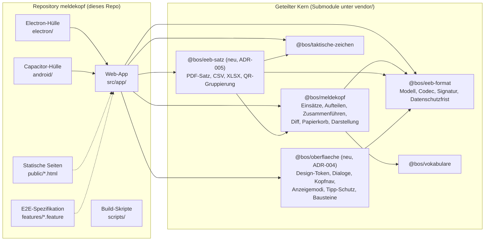
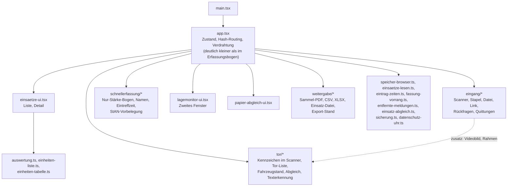
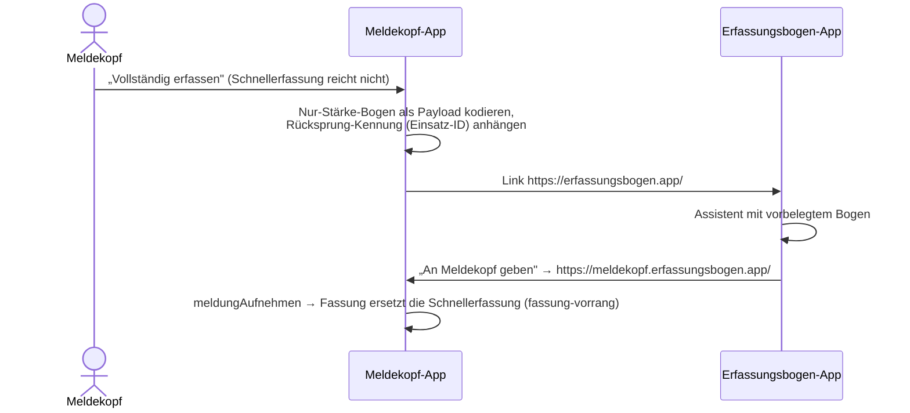
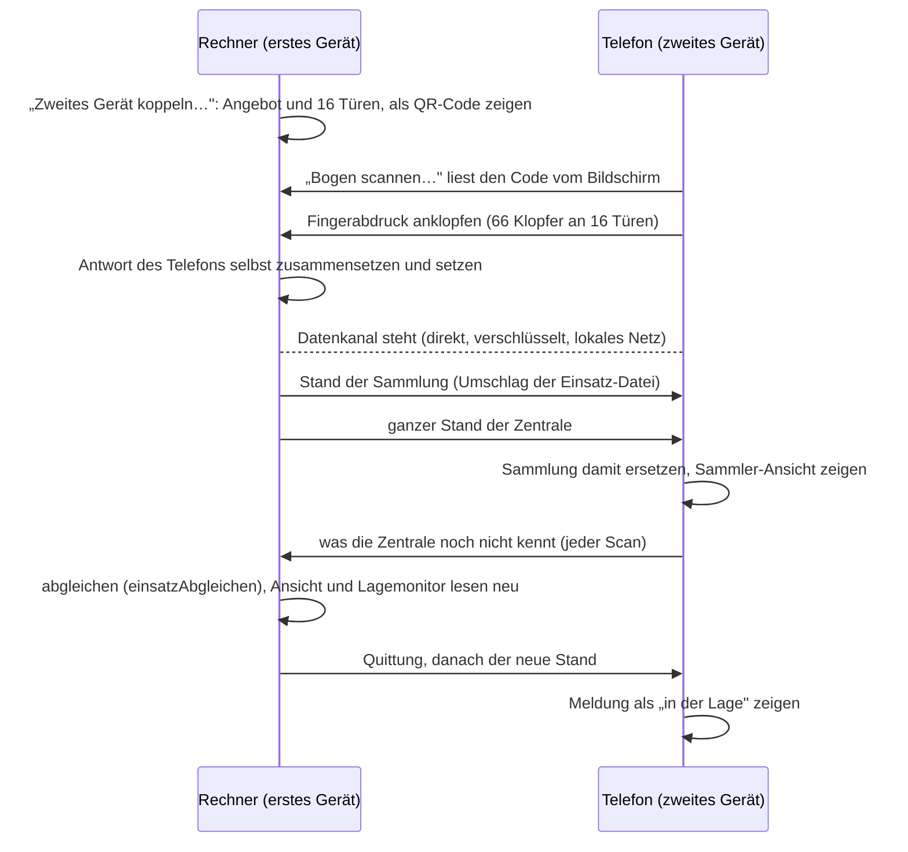

# Architektur der Meldekopf-App (Arc42)

Stand: 2026-10-25, Phase 2 (Sammlung lesen und zeigen) umgesetzt. Dieses Dokument
beschreibt den **Soll-Stand** und wird mit dem Code zum Ist-Stand; wo ein
Abschnitt den Ist-Stand einer Phase nennt, ist er als solcher markiert. Wo es konkrete Zahlen nennt, stammen sie
aus dem Erfassungsbogen (Commit `c789947`, Zweig `claude/lucid-faraday-r4h32d`)
und wurden dort nachgemessen; sie sind als Ausgangsgröße zu lesen, nicht als
Zusage. Die Arc42-Doku des Erfassungsbogens
(`docs/arc42-architektur.md` dort) bleibt die ausführlichere Referenz für
alles, was übernommen wird; hier steht, was anders ist.

## 1. Einführung und Ziele

### 1.1 Aufgabenstellung

Die Meldekopf-App sammelt die Erfassungsbögen eintreffender Einheiten unter
einem Einsatz, zählt Stärke und Sofortbedarf laufend zusammen und gibt die
Lage geschlossen an die nächste Führungsstelle weiter. Sie ist das mittlere
Glied der Produktfamilie:

| App | Rolle |
| --- | --- |
| Erfassungsbogen | Eine Einheit erzeugt ihren Bogen (QR, Link, Datei, PDF). |
| **Meldekopf** | Ein Gerät sammelt viele Bögen und gibt eine Lage weiter (Sammel-PDF, CSV, XLSX, Einsatz-Datei). |
| S1-Control | Der Stab liest die Einsatz-Datei und führt die Lage über Tage, Geräte und Sachgebiete. |

Die Funktionen existieren heute als Einsatz-Sammlung **innerhalb** des
Erfassungsbogens. Sie werden herausgelöst, weil zwei Nutzergruppen mit
verschiedenen Aufgaben dort eine Oberfläche teilen und die Einheit laufend
Fragen beantwortet, die nur den Meldekopf betreffen. Der Funktionsumfang steht
in [funktionsumfang.md](funktionsumfang.md), der Weg der Übernahme in
[uebernahme-aus-erfassungsbogen.md](uebernahme-aus-erfassungsbogen.md).

### 1.2 Qualitätsziele

| Prio | Ziel | Konkret |
| --- | --- | --- |
| 1 | Offline-Fähigkeit | Jede Funktion ohne Netz und ohne Server; kein Gerät hängt von einem anderen ab. Die Kopplung zweier Geräte am selben Meldekopf ist ein Zusatz, ohne den alles weiterläuft (ADR-009). Nach dem ersten Laden läuft die PWA vollständig aus dem Service-Worker-Cache. |
| 2 | Feldtauglichkeit | Bedienbar bei Sonne, Nacht, Handschuhen, Zeitdruck; die Feldtauglichkeits-Ergebnisse des Erfassungsbogens (acht Audit-Runden) gehen vollständig mit. |
| 3 | Datensparsamkeit und Fristen | Nur was die Lage braucht; Datenschutzfrist 90 Tage, Papierkorb 30 Tage, Aufräumfrist 90 Tage; Lagemonitor ohne Personennamen. |
| 4 | Kompatibilität | Alle QR-Codes, Dateien und Sammlungen, die der Erfassungsbogen je erzeugt hat, bleiben lesbar (Schema ab Version 2, `eeb.einsaetze.v1`). |
| 5 | Nachvollziehbarkeit | Jede Handlung der Führungsstelle (Abrücken, Auftrag, Zeitkorrektur) als Vermerk mit Uhrzeit; nichts wird still überschrieben. |
| 6 | Wartbarkeit | Geteilter Kern in Submodulen, keine Kopie von Fachlogik; CI-Gates für Kern-Kopien und Bundle-Budget. |

### 1.3 Stakeholder

| Rolle | Erwartung |
| --- | --- |
| Meldekopf, Leitung Bereitstellungsraum, kleine Führungsstelle | Eintreffende Einheit in Sekunden (QR) oder Minuten (ohne Bogen) aufgenommen; Summen stimmen immer; Weitergabe enthält genau das Neue. |
| Einheit mit Erfassungsbogen | Ihr Bogen wird ohne Rückfragen gelesen; ihre Signatur wird geprüft und gegengezeichnet. |
| Stab mit S1-Control | Bekommt eine Einsatz-Datei, die er ohne Nacharbeit einliest. |
| Einsetzende Organisation (Datenschutz, IT-Sicherheit) | ISK und DSFA als Vorlage; Netzverbindungen nur die eine zur Reichweitenmessung. |
| Entwicklung (ein Entwickler, Claude Code) | Übernahme vor Neubau; Kern bleibt unberührt; Doku wandert mit dem Code. |

## 2. Randbedingungen

### 2.1 Technisch

- **Stack wie der Erfassungsbogen**, damit Build, Release, Härtung und
  Audit-Ergebnisse übernommen werden können: TypeScript, React 19, Vite 8,
  vite-plugin-pwa 2 (Workbox), Vitest 5, Cucumber + Playwright, Electron 45 mit
  electron-updater, Capacitor 8, pdfmake 0.3, pako, @noble/ed25519, zxing-wasm
  und jsQR, tesseract.js 7 (nur im Meldekopf, für das Tor), Node 24. Versionsstände vom 2026-11-26; sie folgen dem
  Erfassungsbogen. Die Kern-Bausteine unter `vendor/` testen weiter mit
  Vitest 4; beide Stände liegen nebeneinander im Baum, was npm erst ab
  Version 11 (Node 24) auflöst.
- **Geteilter Kern als Git-Submodule** unter `vendor/`: `@bos/eeb-format`,
  `@bos/meldekopf`, `@bos/vokabulare`, `@bos/taktische-zeichen`. Gepinnte
  Commits, Vite-Alias auf `vendor/*/src/*.ts`, modulgenaue Importe. Die sechs
  Aufnahmeregeln aus ADR-003 des Erfassungsbogens gelten unverändert
  (Kapitel 9).
- **Kein Backend.** `localStorage` als einzige Ablage, hineingereicht in den
  Kern (`speicherhuelleSetzen`).
- **GitHub Pages** liefert die PWA unter meldekopf.erfassungsbogen.app; **GitHub Releases**
  tragen Installer, APK und Update-Metadaten. Beides ist je Repository, daher
  ein eigenes Repository (ADR-002).
- **Content-Security-Policy** als `<meta>` im Build wie im Erfassungsbogen:
  `default-src 'self' file:`, `object-src 'none'`, `connect-src` und `img-src`
  zusätzlich nur der GoatCounter-Host.

### 2.2 Organisatorisch

- Ein Entwickler, Entwicklung mit Claude Code; Deutsch in Code, Doku, Commits.
- Lizenz EUPL-1.2; taktische Zeichen CC BY 4.0.
- Jeder Push auf `main` baut ein Release mit Datums-Version (Muster
  `release.yml` des Erfassungsbogens); CI auf allen anderen Zweigen.
- Begleitdokumente (dieses, Funktionsumfang, Übernahme, später ISK und DSFA)
  werden im selben Arbeitsschritt wie der Code nachgezogen (`CLAUDE.md`).

### 2.3 Konventionen

- Dateinamen und Bezeichner deutsch, Kebab-Case für Dateien
  (`einsaetze-ui.tsx`), Kopfkommentar je Datei mit Zweck und, bei
  übernommenen Dateien, Herkunft im Erfassungsbogen.
- `localStorage`-Schlüssel mit Präfix `eeb.` und Versionssuffix (`.v1`);
  dieselben Schlüssel wie im Erfassungsbogen für dieselben Daten (ADR-007).
- Keine Systemdialoge, kein Tailwind, kein Router-Framework, kein Redux
  (ADR-002, ADR-007 des Erfassungsbogens).

## 3. Kontextabgrenzung

### 3.1 Fachlicher Kontext

```mermaid
flowchart LR
  Einheit["Einheit<br/>(Erfassungsbogen-App oder Papier)"]
  MK(("Meldekopf-App<br/>(ein Gerät, offline)"))
  TV["Fernseher am Gerät<br/>(Lagemonitor)"]
  Papier["Papier: Sammel-PDF,<br/>Lageblatt, Blanko"]
  Stab["S1-Control<br/>(Stab)"]
  MK2["Zweites Meldekopf-Gerät<br/>(Ablösung)"]

  Einheit -->|"QR-Code, Link, Datei, PDF,<br/>Foto, Handscanner"| MK
  MK -->|"„Vollständig erfassen"<br/>Link mit Payload"| Einheit
  MK -->|"zweites Fenster"| TV
  MK -->|"Sammel-PDF, Lageblatt"| Papier
  Papier -->|"Scan + Lage vom Papier abgleichen"| MK
  MK -->|"Einsatz-Datei, CSV"| Stab
  MK <-->|"Einsatz-Datei, Sammel-PDF"| MK2
```

| Partner | Schnittstelle | Beschreibung |
| --- | --- | --- |
| Einheit mit Erfassungsbogen | QR (`EEB2`/`EEB2C`, Base41, segmentiert), Link `https://meldekopf.erfassungsbogen.app/#<Payload>`, JSON-Datei, PDF mit QR | Eingang in die Sammlung; Signatur wird geprüft und gegengezeichnet. |
| Einheit ohne Bogen | Bedienoberfläche (Schnellerfassung) | Nur Stärke, Führungskraft, Fahrzeuge; für mehr wird der Erfassungsbogen per Link geöffnet (ADR-006). |
| Erfassungsbogen-App | Link in beide Richtungen | Gleicher Payload wie der QR; von dort kommt „An Meldekopf geben", von hier „Vollständig erfassen". |
| S1-Control | Einsatz-Datei (JSON-Umschlag), CSV | Leser `einsaetzeAusJson` liegt im Kern; der Umschlag trägt Export-Stände und Lage-Angaben. |
| Zweites Meldekopf-Gerät | Einsatz-Datei, Sammel-PDF; seit 2026-11-24 wahlweise gekoppelt über eine direkte Verbindung im lokalen Netz | Ablösung und Rückimport mit Abgleich je Feld (`einsatz-abgleich`). Gekoppelt (Telefon scannt draußen, Rechner zeigt die Übersicht) reist derselbe Umschlag der Einsatz-Datei mit demselben Abgleich, nur ohne Datei in der Hand (`kopplung/`, ADR-009). |
| Papier | Sammel-PDF, Lageblatt, Blanko | Referenzformat und Rückfallebene nach Geräteausfall. |
| USB-Handscanner | Tastatur-Emulation | Wie im Erfassungsbogen. |
| Excel-Vorlage „Oldenburg" | entfällt seit 2026-11-09 | Wie im Erfassungsbogen (2026-11-03) gestrichen; für Tabellen bleibt die CSV, die Gegenstelle übernimmt Bögen über Link oder PDF. |

### 3.2 Technischer Kontext

| System | Richtung | Zweck | Protokoll |
| --- | --- | --- | --- |
| GitHub Pages (meldekopf.erfassungsbogen.app) | eingehend, einmalig; danach Prüfung auf neue Fassung | Auslieferung der PWA; danach offline. Die App fragt beim Laden, das offene Hauptfenster außerdem stündlich, nach mindestens zehn Minuten im Hintergrund beim Zurückkommen und bei wiederkehrendem Netz die Datei `sw.js` derselben Herkunft ab, ob eine neue Fassung bereitliegt (seit 2026-11-13, `aktualisierung.tsx`); das Fenster des Lagemonitors fragt nicht selbst; kein Fremd-Host, ohne Netz scheitert die Frage still | HTTPS, statische Dateien |
| GoatCounter (`meldekopf.goatcounter.com`, eigene Site dieser App; Host in `src/app/adressen.ts`) | ausgehend | Cookielose Reichweitenmessung, ein Treffer je Kaltstart (das Lagemonitor-Fenster zählt nicht mit, `main.tsx`); einziger Fremd-Host in der CSP. Bewusst ohne das offizielle `count.js` von `gc.zgo.at` (wie im Erfassungsbogen): `statistik.ts` baut den Treffer selbst gegen dieselbe Zähl-URL `/count`, sonst wäre `gc.zgo.at` ein zweiter Fremd-Host und das Skript scheiterte unter `file://` und `capacitor://`. | HTTPS `sendBeacon` / Bild |
| GitHub Releases | ein-/ausgehend | Installer, APK, `latest*.yml` für electron-updater | HTTPS |
| Capacitor-Plugins | intern | Barcode-Scanner, Dateisystem, Teilen, App-Links | Bridge |
| Erfassungsbogen (`erfassungsbogen.app`) | ausgehend, nur auf Knopfdruck | „Im Erfassungsbogen öffnen“ in der Rückfrage zu einem empfangenen Bogen (`eingang/aufnahme.tsx`, seit Phase 3): ein neuer Tab bzw. der Systembrowser lädt den Erfassungsbogen. Der Bogen steht nur im Fragment (`#…`), das der Browser nicht an den Server schickt; nach Ablauf der Datenschutzfrist ohne Personendaten. Keine Verbindung aus der App selbst, die CSP bleibt unverändert. | HTTPS, Navigation |
| Zweiter Bildschirm | intern | Lagemonitor als zweites Fenster derselben Herkunft, liest denselben `localStorage` | `window.open`, `storage`-Ereignis |
| Zweites Gerät am selben Meldekopf (Kopplung, seit 2026-11-24) | ein- und ausgehend, nur nach Tausch zweier QR-Codes von Hand | Abgleich einer Sammlung zwischen zwei Geräten im selben lokalen Netz (WLAN des Fahrzeugs, Hotspot), ohne Internet. Die Verbindung geht direkt von Browser zu Browser; es gibt keinen Vermittlungs-, STUN- oder TURN-Server (`iceServers` leer), also auch keinen Fremd-Host. Die Geräte nennen einander nur Adressen im lokalen Netz; diese und der Fingerabdruck des Verbindungsschlüssels stehen im QR-Code auf dem Bildschirm. Ohne gemeinsames Netz kommt keine Verbindung zustande. `src/app/kopplung/`, ADR-009 | WebRTC-Datenkanal (SCTP über DTLS über UDP) |

Es gibt **kein Backend, keine Datenbank, keine Nutzerkonten.** Jede neue
Netzverbindung ist eine Änderung an diesem Kapitel, an der CSP und an der
DSFA.

## 4. Lösungsstrategie

1. **Reines Client-System**, wie der Erfassungsbogen (dort Kap. 4.1).
2. **Eine Web-Codebasis, drei Hüllen**: Browser/PWA, Electron, Capacitor.
3. **Geteilter Kern** unverändert übernehmen; was beide Apps brauchen und
   keine Oberfläche ist, wandert zusätzlich in den Kern (ADR-005); was beide
   brauchen und Oberfläche ist, in einen Oberflächen-Baustein mit eigenen
   Regeln (ADR-004).
4. **Übernahme statt Neubau**: Module der Einsatz-Sammlung kommen mit ihren
   Tests, Kopfkommentaren und Audit-Begründungen; Umbenennungen nur, wo der
   Name den Erfassungsbogen voraussetzt.
5. **Kein Assistent in dieser App** (ADR-006): Schnellerfassung ja, der
   vollständige Bogen per Link im Erfassungsbogen.
6. **Gleiche Speicherschlüssel** wie der Erfassungsbogen (ADR-007), damit
   Datensicherung und Einsatz-Datei ohne Umbau hin- und herwandern.
7. **Harte Grenze zu S1-Control** (ADR-008): ein Meldekopf, offline, eine
   Weitergabe. Ein zweites Gerät am selben Meldekopf darf gekoppelt werden
   (ADR-009); jedes der beiden bleibt für sich vollständig.

## 5. Bausteinsicht

### 5.1 Gesamtsystem (Level 1)



| Baustein | Verantwortung | Herkunft |
| --- | --- | --- |
| Web-App (`src/app/`) | Einsatzliste, Einsatzansicht, Eingänge, Schnellerfassung, Lagemonitor, Papier-Abgleich, Exporte, Persistenz-Anbindung, Plattform. | Erfassungsbogen `src/app/`, Meldekopf-Anteil (rund 14.700 Zeilen Produktivcode, siehe Übernahme-Doku) |
| `@bos/eeb-format` | Datenmodell (`SCHEMA_VERSION` 13), Codec, Signatur, Datenschutzfrist. | vorhanden |
| `@bos/meldekopf` | Einsatz-Sammlung als reine Logik: Revisionen, Dedupe, Fristen, Aufteilen, Zusammenführen, Diff, Papierkorb, Text-Darstellung. | vorhanden (3.167 Zeilen) |
| `@bos/vokabulare`, `@bos/taktische-zeichen` | Nachschlagetabellen, Zeichenauflösung. | vorhanden |
| `@bos/eeb-satz` (<https://github.com/wattnpapa/bos-eeb-satz>) | Was beide Apps ausgeben und keine Oberfläche ist: pdfmake-Dokumentdefinition (Einzel- und Sammel-PDF, Lageblatt), CSV-Schreiber, XLSX-Schreiber, Oldenburg-Spalten, QR-Gruppierung mehrteiliger Bögen, PDF-Bild-Leser. | neu, aus `pdf-dokument.ts` (2.258), `bogen-csv.ts` (423), `einsatz-csv.ts` (290), `oldenburg-xlsx.ts` (615), `xlsx.ts` (319), `csv.ts` (51), `qr-boegen.ts` (48), `pdf-bilder.ts`, `pdf-stroeme.ts`, `pdf-qr.ts`. **Ist-Stand Phase 1:** erste Stufe `csv`, `xlsx`, `pdf-stroeme`, `pdf-bilder`, `taktische-zeichen-bogen`, `uebung-wasserzeichen`; der Rest hängt im Erfassungsbogen an App-Modulen (ADR-005, Nachtrag) |
| `@bos/oberflaeche` (<https://github.com/wattnpapa/bos-oberflaeche>) | Was beide Apps zeigen: Design-Token (CSS), Dialogschicht, Modal-Overlay, Kopfnavigation, Anzeigemodi, Organisationsfarben, Tipp-Schutz, Schriftstufen, Tastatur-Erkennung, Quittungen, Feld-Bausteine. **Darf React und DOM**, aber keine Fachlogik und keine Persistenz außer den eigenen Anzeige-Schlüsseln. | neu, aus `dialoge.tsx` (487), `modal-overlay.ts` (259), `kopfnav.ts`/`kopfnav-ui.tsx` (338), `anzeige-modus.ts`/`anzeige-schalter.tsx` (383), `org-farben.ts` (358), `tipp-schutz.ts` (288), `schrift-stufe.ts`, `tastatur.ts`, `daumen-quittung.tsx`, `schritte/bausteine.tsx` (742, Auswahl). **Ist-Stand Phase 1:** vollständig nach Abschnitt C der Übernahme-Doku, dazu `zahl-eingabe` und `stil/token.css` |
| Electron-Hülle | Fenster, Auto-Update, Berechtigungen, Lagemonitor-Fenster. | `electron/main.js` |
| Capacitor-Hülle | Android-Projekt; iOS folgt. | `android/`, `capacitor.config.json` |
| Statische Seiten | Anleitung, Datenschutz, Impressum; weniger als beim Erfassungsbogen (keine Organisations-Landingpages). | `public/` (Auswahl) |

### 5.2 Web-App (Level 2)



Die Unterverzeichnisse `eingang/`, `schnellerfassung/`, `weitergabe/` sind
neu; im Erfassungsbogen liegt alles flach in `src/app/`. Sie gliedern die
übernommenen Dateien nach dem Ablauf am Meldekopf (Eingang, Erfassung, Lage,
Weitergabe), ohne Dateien zu zerschneiden.

`kopplung/` (seit 2026-11-24, ADR-009) ist der einzige Teil ohne Vorlage im
Erfassungsbogen. Im Startbündel liegen davon nur `zustand.ts` und
`kopplung-rahmen.tsx`; alles andere lädt mit der ersten Kopplung.

**Ist-Stand Phase 2 (2026-10-25):** Die Sammlung ist da. `app.tsx` trägt die
Startseite mit der Weiche „Bögen sammeln" (laufende Sammlungen öffnen, neue
anlegen), die Einsatzliste und die zuletzt offene Sammlung
(`letzter-einsatz.ts`, 12 h). Die offene Sammlung zeigt `einsatz-ansicht.tsx`:
`EinsatzDetail` aus `einsaetze-ui.tsx` mit den Ausgabewegen (Sammel-PDF,
Lageblatt, Blanko, CSV, Alle-Daten-CSV, Export-Stand je
Format; die Excel-Liste „Oldenburg" ist seit 2026-11-09 entfallen). Übernommen ist der ganze Abhängigkeitsbaum von `einsaetze-ui`
(rund 20.000 Zeilen aus `441811c`, mit Tests): Persistenz-Anbindung,
Auswertung, Einheitenliste und -tabelle, Fassungs-Vorrang, Fristen und Uhr,
Datensicherung, Aufteilen/Zusammenführen, Lagemonitor, Papier-Abgleich,
PDF-Satz und Exporte unter `weitergabe/`, QR-Leser und Unlesbares unter
`eingang/`, `nacherfassung`/`nur-staerke` unter `schnellerfassung/`. Die
Fußzeilen-Gruppe „Daten" steht in `daten-gruppe.tsx`. „Was ist neu“ an der
Versionsnummer der Fußzeile (`useAenderungen` in `fusszeile.tsx`) lädt den
Änderungsverlauf `aenderungen.ts` erst beim Öffnen als eigenen Brocken nach;
er liegt wie jeder JS-Baustein im Kern des Offline-Vorrats. `main.tsx` verdrahtet
Speicher, geprüfte Uhr, Fehlerfänger (aus `@bos/oberflaeche`, mit Sichern und
Löschen dieser App) und das Lagemonitor-Fenster. Die Eingänge (Scan, Datei,
Bilderstapel, Link) liegen seit Phase 3 unter `eingang/`, die
Schnellerfassung seit Phase 4 unter `schnellerfassung/`; `app.tsx` lädt sie
erst auf Knopfdruck nach (`React.lazy`), weil sie OV-Verzeichnis und
StAN-Tabellen mitbringt. `vorlagen.ts` und `uebergabe-stand.ts` liegen als reine
Datenmodule bei, damit eine Sicherung aus dem Erfassungsbogen verlustfrei
bleibt. Die Stilregeln der Sammlung (518 Regeln aus der `index.html` des
Erfassungsbogens, nach den benutzten Klassen ausgewählt, mit ihren
Audit-Kommentaren) stehen in der `index.html` zwischen den Token und der
Kennfarbe.

**Verlauf der Ansichten (Audit Runde 1):** Startseite, Einsatzansicht und
Schnellerfassung stehen als Einträge im Browserverlauf, damit Zurück in der
App bleibt (`ansicht-verlauf.ts`). Die Ansicht steht in `history.state`
(`eebAnsicht`), nicht im Fragment: Das Fragment trägt die Bogen-Links und wird
nach dem Lesen aus der Adresse genommen. Nichts davon landet im
`localStorage`; nach einem Neuladen gilt wie bisher `eeb.letzterEinsatz.v1`.

Ist-Stand Phase 1, weiter gültig: `src/app/` enthält `main.tsx`, `app.tsx`
(nur Startseite), `start-inhalt.ts`, `adressen.ts` (Domain und Zähl-Host an
einer Stelle), `kennfarbe.ts` (Petrol, wird dem Anzeigemodus hineingereicht),
`fusszeile.tsx` (gekürzt), `nativ.ts` und `aktualisierung.tsx` (je auf den
Web-Teil gekürzt), `statistik.ts`, dazu `kopfnav.ts` und `werkzeuge.ts` nur
noch mit den Daten dieser App. Die Phase-0-Kopien (`dialoge`,
`modal-overlay`, `anzeige-modus`, `anzeige-schalter`, `tipp-schutz`,
`tastatur`, `schrift-stufe`, `kopfnav-ui`, `seiten-kopf`) sind entfallen; sie
kommen aus `@bos/oberflaeche`. Die Design-Token stehen dort als
`stil/token.css` und werden beim Bauen an der Marke `/* oberflaeche:token */`
in den Inline-Stil der `index.html` gesetzt (Plugin `oberflaeche-token` in
`vite.config.ts`); die Kennfarbe steht davor, alle übrigen Regeln danach.
Die Tests, die an der `index.html` dieser App hängen (Boot-Skript,
Kennfarbe), liegen unter `src/test/`.

### 5.3 Zuordnung Anforderung → Baustein

| Anforderung | Bausteine |
| --- | --- |
| Bogen aufnehmen | `eingang/*`, `@bos/eeb-format/codec`, `@bos/meldekopf/einsaetze`, `eintrag-zeiten.ts` |
| Einheit ohne Bogen erfassen | `schnellerfassung/*`, `@bos/vokabulare`, `@bos/oberflaeche` (Bausteine); die eigene Erfassung nachträglich berichtigen: `schnellerfassung/berichtigung.tsx` |
| Lage lesen | `einsaetze-ui.tsx`, `auswertung.ts`, `einheiten-liste.ts`, `einheiten-tabelle.ts`, `erreichbarkeit.ts` (Führung, Funkrufname, Fahrzeuge für Karte, Tabelle, Suche, Lagemonitor), `lage-zusatz.ts` (Fahrzeuge, Stärke je Organisation, Abgerückte, Stärkemeldung), `bedarf-aendern.ts` (nachgeladen) |
| Lagemonitor | `lagemonitor-ui.tsx`, `lagemonitor.ts`, `lage-angaben.ts`; Tafel-Ansicht `lagetafel-ui.tsx`, `lagetafel.ts`, Wahl der Ansicht `lagemonitor-ansicht.ts` |
| Weitergabe | `weitergabe/*`, `@bos/eeb-satz`, `export-stand.ts`, `einsatz-transport.ts` |
| Ablösung und Rückimport | `einsatz-abgleich.ts`, `entfernte-meldungen.ts` |
| Mehrere Geräte am selben Meldekopf | `kopplung/*`: `kopplung.ts` (führt die Gegenstellen, fasst ihren Zustand zusammen), `gegenstelle.ts` (alles, was dieses Gerät mit genau einem anderen verbindet), `geraetename.ts`, `merker.ts`, `signal.ts` (Kopplungs-Code, Türen und Klopf-Zeichen), `verbindung.ts` (WebRTC-Datenkanal), `abgleich.ts` und `sitzung.ts` (wann welcher Stand hinübergeht; ruft `einsatz-transport.ts` und `einsatz-abgleich.ts`), `kopplung.ts` (Steuerung), `kopplung-leiste.tsx` (Lampe, Leiste), `sammler-ansicht.tsx`, `kopplung-dialog.tsx`, `zustand.ts` |
| Papier-Rückfallebene | `papier-abgleich-ui.tsx`, `papier-abgleich-entwurf.ts` |
| Fristen | `@bos/eeb-format/datenschutzfrist`, `datenschutz-uhr.ts`, `@bos/meldekopf` (Papierkorb, Aufräumfrist) |

## 6. Laufzeitsicht

### 6.1 Bogen aufnehmen

Unverändert aus dem Erfassungsbogen (dort Kap. 6.3): Eingang → Fingerabdruck
→ Dedupe → Revision oder neuer Eintrag → Diff → Persistieren → Summen. Alle
Eingänge laufen über `meldungAufnehmen` (`eintrag-zeiten.ts`); eine neue
Fassung erbt Eintreffzeit, Auftrag und Teil-Etikett der Vorgängerin. Ein
Zug-Etikett aus älteren Sammlungen (`zugEtikett` im Kern) bleibt in den Daten
und reist mit Datei, Sammel-PDF und Datensicherung mit; die App zeigt und
bearbeitet es nicht mehr (Zug-Funktion entfallen am 2026-11-11).

### 6.2 Vollständiger Bogen über den Erfassungsbogen



Offen (Gerätetest): ob der Wechsel zwischen zwei installierten PWAs auf iOS
ohne Netz sauber läuft. Auf Android und Desktop öffnet der Link die
installierte App oder den Browser-Tab; beide bedienen den Service Worker.
Rückfallebene ist immer der QR-Code auf dem Bildschirm des anderen Geräts.

### 6.3 Weitergabe an S1-Control

Einsatz-Datei schreiben (`einsatzDateiInhalt`: Sammlung, Export-Stände,
Lage-Angaben) → Export-Stand je Format vermerken → Datei teilen (nativ) oder
speichern. S1-Control liest mit `einsaetzeAusJson` aus dem Kern. Ob
S1-Control den Umschlag mit Ständen und Lage-Angaben schon versteht, ist zu
prüfen (Kapitel 11).

### 6.4 Lagemonitor

Zweites Fenster derselben Herkunft (`?lagemonitor=<Einsatz-ID>`), liest
`eeb.einsaetze.v1` und die Lage-Schlüssel, hört auf `storage`, hält den
Bildschirm wach (Wake Lock, wo verfügbar). In Electron öffnet der Hauptprozess
dafür ein eigenes Fenster; die Berechtigungsregel lässt genau diese Adresse zu.

Der Monitor hat zwei Ansichten. `Lagemonitor` (`lagemonitor-ui.tsx`) verwaltet
für beide Daten, Takt, Helligkeitsstufe und Fenster und zeigt entweder die
übernommenen **Zeilen** oder die **Tafel** (`lagetafel-ui.tsx`, neu im
Meldekopf, als eigener Brocken nachgeladen). Die Wahl liegt geräteweit unter
`eeb.lageansicht.v1` und wandert wie die Lage selbst über das
`storage`-Ereignis: Die Einsatzansicht stellt den offenen Fernseher um. Die
Adresse des Fensters bleibt dieselbe, die Regel der Electron-Hülle auch.

Die Tafel rechnet ihren Satz selbst (`tafelSatz` in `lagetafel.ts`, reine
Rechnung ohne Browser): aus Zahl und Gliederung der Einheiten und der
gemessenen Fläche die größte Schrift, bei der alles auf eine Seite passt, in
einer von drei Fassungen der Einheitenkarte. Dazu kommt der Platzbedarf des
Inhalts (`satzBedarf` aus `kartenBedarf` und `namenBedarf`): Gibt es einen
Satz, in dem nichts gekürzt wird, gewinnt er, solange seine Schrift gut
lesbar bleibt oder höchstens ein Zehntel kleiner ist; sonst gilt dasselbe für
die Namen allein, denn sie sagen, wer da ist. Erst wenn auch das zu viel
kostet, wird gekürzt, statt allen die Schrift zu nehmen oder die Tafel
blättern zu lassen. In der breiten Fassung teilen sich alle Karten die
Spalte der Namen: Ihr Bedarf entsteht aus dem längsten Namen und dem
längsten Auftrag über alle Karten, und ein Name, der mehr als 62 % der Karte
bräuchte, passt dort nie (seit 2026-11-12; vorher galt der breite Satz als
ungekürzt, obwohl Name und Auftrag gekürzt dastanden). „Alles ganz“ schließt
die Namen ein. Geschätzt wird ohne Browser, aus einer Tabelle der
Zeichenbreiten der Tafelschrift (`textBreite`, im Browser gemessen; jede
Gruppe so breit wie ihr breitestes Zeichen). An 52 gemessenen Namen liegt
die Schätzung nie zu knapp und 1 bis 9 % zu weit, meist 2 bis 5 %. Ein
fester Mittelwert je Zeichen lag bei Namen zwischen 10 % zu knapp und 15 %
zu weit.

Namen bleiben erkennbar, in dieser Folge: Passt der volle Name nicht, steht
seine übliche Kurzform da (`kurzName`, `herkunftKurzform`: „FF Lenglern“,
„DRK-KV Buchenrode“, „Bw KVK Göttingen“, „KFB“, „OV“, „OG“ …; die
Gliederungen wie in den Vokabularen der Ebenen, Groß- und Kleinschreibung und
doppelter Leerraum zählen nicht). Sie springt nur ein, wo sie schmaler ist
als die volle Form, beim Typ wie beim Namen. Die Wahl trifft die Stilvorlage
ohne Messung wie beim Typ: Der volle Name liegt hinter einem Anker ohne
Breite über der Kurzform und bricht, wenn er nicht passt, in eine Zeile um,
die nicht zu sehen ist. Fehlt der Form, die dann steht, nur wenig, läuft sie
bis auf neun Zehntel kleiner (`--lt-name-em` mit einer Container-Abfrage, nur
in den Fassungen, in denen die Breite des Namens nicht an seinem Inhalt
hängt), auf der Grundlinie des Namens in voller Größe (eine Stütze ohne
Breite gibt sie vor). Erst danach wird der breitere Teil gekürzt
(Organisation oder Standort, nach geschätzter Breite gewählt); von ihm
bleiben mindestens drei Zeichen, und reicht auch das nicht, endet der andere
Teil mit Auslassung statt hart am Rand. Der Satz rechnet mit der Kurzform.
Im Gruppenkopf bekommt die Zahl der Einheiten nur den Platz, der neben Name
und Stärke übrig bleibt, und steht ganz oder gar nicht (hinter einem Anker
wie der Typ): Ein Schwundfaktor allein nahm dem Namen Bruchteile eines
Pixels, und schon die lösten die Auslassung aus („T… (Fortsetzung)“); eine
gekürzte Zahl las sich als „1“ für „16 Einheiten“. In den Zeilen der
Übungsmeldungen geht der Name von der Breite seiner Kurzform aus und wächst
bis zur vollen; gekürzt wird zuerst der Typ. In der dritten Zeile der Karte
weichen Auftrag und dann Kennwort und Ort des Funkrufnamens, bevor der
Bedarf gekürzt wird. Von Kennwort und Ort bleiben mindestens drei Zeichen;
passen die nicht neben die Kennziffer, steht sie allein (ohne Messung wie
beim Typ: Der ganze Funkrufname liegt mit seiner Mindestbreite hinter einem
Anker über der Kennziffer und bricht, wenn er nicht passt, in eine Zeile um,
die nicht zu sehen ist). Die Mindestbreite rechnet mit der normal gesetzten
Schrift des Funkrufnamens (0,93 der fetten Schätzung, gemessen 0,86 bis
0,92). Bis 2026-11-12 stand dort „R.. 55/17/4“ mit angeschnittener
Auslassung. In der breiten Fassung hält die Spalte des Funkrufnamens seine
Kennziffer frei (`--lt-funk-fest`); an 16:10-Fernsehern blieb sonst von
„22/51“ nur „2..“. Die Spalte „wer“ misst nur, was nicht an ihrer eigenen
Breite hängt: den ganzen Funkrufnamen mit seinen Teilen (nicht seine Hülle)
und für die Marken, was sie ganz brauchen, mit Polster, Rahmen und Abständen
(nicht ihre Spur im Raster). Hing die Messung an der Spalte, sank diese je
Bild um einen Pixel, und nach 50 Durchgängen brach React ab und der
Fernseher zeigte die Zeilen: über die Hülle des Funkrufnamens im Stand
`c053757` (nie ausgeliefert), über die Spur der Marken schon im
ausgelieferten Stand `b1254c0`, sobald in der breiten Fassung eine Karte
ohne Funkrufnamen einen langen Bedarf neben einem langen Namen trug.
Gebraucht werden seitdem zwei oder drei Messungen; zur Sicherheit ändert
`useWerBreite` die Breite in einem Zug höchstens achtmal.

In der knappen Fassung teilen sich Typ, Auftrag und Marken die zweite Zeile
neben dem Stand. Es weicht zuerst der Auftrag, dann der Bedarf. Eine
Kurzform des Vokabulars („FGr WP (A)“, „B (Fachberater)“) wird nie gekürzt:
Ihr Anfang („FGr…“) passt auf zwei Dutzend Fachgruppen, und gekürzt las
sich „FGr S…“ wie eine andere Einheit. Ein Freitext-Typ („SEG Betreuung …“)
weicht nur so weit, dass die Bewegung und der Anfang des Bedarfs („⚠ Ver…“)
stehen (`--lt-marken-min`). Bis 2026-11-12 blieb vom Bedarf neben einem
langen Freitext-Typ und „Stärke −2“ eine Viertelstunde lang nur ein leerer
Rahmen. Neben einer langen THW-Kurzform und „Stärke −2“ kann das auf der
kleinsten Karte weiter geschehen; den Bedarf nennt dann die Randspalte.

Die Stilvorlage bekommt dieselben Maße als CSS-Eigenschaften hineingereicht, es
gibt eine Quelle für Rechnung und Satz. Im Browser gemessen wird nur
zweierlei: die Fläche und, in der breiten Fassung, die Breite der Namen
(`--lt-wer`), nach der sich die linke Spalte aller Karten richtet: so breit,
dass jede Kurzform ganz dasteht, und so breit wie der längste volle Name,
soweit Auftrag und Funkrufname daneben nicht gekürzt werden. Die Summen
kommen unverändert aus `lagebild` (`lagemonitor.ts`); beide Ansichten zeigen
dieselben Zahlen.

Abgerückte Einheiten gehören nicht in diesen Satz: Die Randspalte führt die
zuletzt abgerückten mit Uhrzeit, unabhängig davon, wie voll die Tafel ist
(ein Block, der mit dem Füllstand kommt und geht, wäre kein festes Lagebild).
Ein langer Name endet dort mit Auslassung, „(Übung)“ dahinter bleibt stehen;
bis 2026-11-12 ragte die Zeile über die Randspalte hinaus und wurde mitten im
Wort abgeschnitten.
Auf der Tafel stehen sie nur, wenn niemand mehr anwesend ist. Beim Blättern
laufen die Gruppen über Spalten und Seiten weiter, statt Platz frei zu
lassen; die Seitenzeile nennt die Gruppen der Seite und der nächsten. Gruppiert
wird nach Organisation.

Übungsmeldungen einer echten Lage zählen nicht (`zaehltInLage` in
`auswertung.ts`), stehen aber auf der Tafel: als eigene, letzte Gruppe über
alle Organisationen hinweg, mit „nicht gezählt“ am Kopf statt einer Summe,
jede als knappe Zeile. Stünden sie bei ihrer Organisation, ergäben deren
Karten nicht mehr deren Summe. Ihr Bedarf und ihre Bewegungen gehen wie in
`lagebild` in nichts ein; die Randspalte nennt sie bei der Zahl der
Einheiten, damit sie beim Blättern auf jeder Seite erwähnt sind. Die
Zeilenansicht nennt sie weiter nur als Zahl.

Die Randspalte hat eine Rangfolge. Alles über dem Fuß steht in einer Hülle,
die die Höhe nimmt, die der Fuß lässt. Die festen Blöcke (Zähler, Dauer,
Bedarf, Abgerückt) stehen immer; „Zuletzt“ steht nur, wenn danach noch
seine Überschrift Platz hat, sonst entfällt es samt Linie. Was dann noch
übersteht, schneidet die Hülle ab. Datenstand und Bedienung bleiben so
immer im Bild.

Lässt sich der Brocken der Tafel nicht nachladen (ein lange offenes
Monitor-Fenster nach einem Update der App), fängt eine Fehlergrenze in
`lagemonitor-ui.tsx` das ab: Der Monitor zeigt die Zeilen, sagt es und bietet
„Neu laden“ an, statt leer zu bleiben. Dieselbe Grenze fängt einen Fehler
beim Zeichnen der Tafel.

### 6.5 Offline-Start, Auto-Update

Wie im Erfassungsbogen (dort Kap. 6.4, 6.5): zweistufiger Vorrat (Kern vom
Service Worker, Zusatz nachgeladen), Update-Banner im Web, electron-updater
gegen die Releases dieses Repos.

Seit 2026-11-13 sucht das offene Hauptfenster selbst nach einer neuen
Fassung: stündlich, nach mindestens zehn Minuten im Hintergrund beim
Zurückkommen und wenn das Netz wiederkommt (`aktualisierungStarten` in
`aktualisierung.tsx`, gestartet in `main.tsx`, einmal je Fenster). Vorher
fragte die App nur beim Laden; ein Laptop, der den ganzen Einsatz lief,
erfuhr von einer neuen Fassung nichts. Aktiviert wird eine neue Fassung weiter
nur auf „Neu laden“ im Hinweis des Hauptfensters, oder wenn alle Fenster der
App geschlossen waren; ein einzelnes, hart neu geladenes Fenster zählt für
den Browser wie geschlossen, dort aktiviert er die Fassung mit der nächsten
Suche selbst. Nach „Später“ steht der Hinweis mit der nächsten Suche wieder
da, solange die Fassung wartet, auch in einem hart neu geladenen Fenster:
Gefragt wird die Registrierung, nicht die Steuerung der Seite. Die
Installation verfolgt die App selbst; die Bibliothek hört nach einer
abgebrochenen nicht mehr hin, und der Hinweis kam dann eine Stunde zu spät.
Seit 2026-11-17 klebt der Hinweis oben im Bild (unter der festen Warnleiste),
statt im Seitenfluss über dem Bildrand zu stehen, mit Knöpfen in voller
Trefferfläche, und er sagt, dass „Neu laden“ alle Fenster der App neu startet.

Sobald eine neue Fassung die Steuerung übernimmt, lädt jedes Fenster der App
neu, gleich in welchem sie aktiviert wurde. Weiterlaufen kann keins: Die neue
Fassung räumt beim Aktivieren die Bausteine der alten aus dem Vorrat, und auf
dem Server liegen sie nach dem Ausrollen auch nicht mehr. Die nächste
nachgeladene Ansicht stürzte mit „ohne Netz“ ab, obwohl Netz da ist. Für
Hauptfenster, die den Hinweis gesehen hatten, tat das schon die Bibliothek;
jetzt gilt es für alle, auch für das Fenster des Lagemonitors, das vorher alt
blieb, selbst wenn man es neu lud. Eine angefangene Erfassung übersteht das
Neuladen (Entwurf), ein an einer Karte angefangener Auftrag wird beim Verlassen
der Seite gesichert (R11-O1). Verloren gehen, wie schon vorher beim Neuladen
durch die Bibliothek, Eingaben in offenen Dialogen (Stärke, Ort, Aufteilen,
Zeitkorrektur), eine laufende Übergabe-PDF, „Rückgängig“ an einer Quittung
sowie Suche, Filter und Sortierung der Tabelle. Ein Hauptfenster, das so von
selbst neu startet, sagt es danach: „Neue Version geladen: Dieses Fenster ist
von selbst neu gestartet. Eingaben in einem offenen Dialog wurden nicht
übernommen.“ Übernimmt die Fassung eine Seite, die vorher ungesteuert war
(Erstinstallation, oder an Service Worker und Vorrat vorbei hart neu geladen),
oder lief die Übernahme, während die Seite lud, entscheidet der Vorrat: Liegt
der Baustein der Seite in keinem Workbox-Vorrat der Herkunft mehr, lädt sie
neu, einmal je Fassung und Fenster (`fassungVeraltet`). Durchsucht werden alle
Vorräte; liegt auf derselben Herkunft eine zweite App, stand ihr Vorrat
womöglich vorn. Ist die Seite nach dem einen Neuladen weiter „veraltet“, irrt
die Prüfung (etwa ein beschädigter Vorrat), und es bleibt still.

Das Fenster des Lagemonitors zeigt keinen Hinweis, sucht nicht selbst und
meldet den Service Worker nicht an (wie vor 2026-11-13; seine Anmeldung kurz
nach dem Öffnen ließ im Wettlauf mit „Neu laden“ das Hauptfenster hängen); es
folgt dem Hauptfenster. Ein Monitor ohne Hauptfenster läuft mit seiner Fassung
weiter, deren Bausteine im Vorrat bleiben, bis eine neue aktiv ist; die
aktiviert das nächste Hauptfenster auf „Neu laden“. Ein Hinweis im Monitor
kostete am 720p-Fernseher die Zeile „+ n weitere Einheiten“ und am Rand das
Ende von „Abgerückt“, und eine dort aktivierte Fassung hätte das Hauptfenster
unter einer laufenden Eingabe neu geladen. Stufe und Vollbild überstehen das
selbsttätige Neuladen einmal: „Hell“ bleibt, obwohl es sonst nie gemerkt wird
(R7-L3), und das Vollbild, das der Browser nur auf einen Tipp hin einschaltet,
holt der erste Klick oder Tipp ins Fenster zurück, auch per Touch (gehorcht
wird auf „click“). Bis dahin gilt es weiter als gewollt, auch über ein
weiteres Neuladen. Offen bleibt ein Fall, der nur per Skript erreichbar ist:
„Neu laden“ in den ersten Hundertstelsekunden nach dem Öffnen des Monitors
lässt dessen Fenster leer, wie vorher; F5 hilft.

### 6.6 Zwei Geräte koppeln (seit 2026-11-24, ADR-009)

Fall: Der Rechner im Fahrzeug zeigt die Übersicht, das Telefon scannt draußen.
Beide hängen im selben Netz, Internet gibt es nicht.



- **Ein Scan genügt (seit 2026-11-25, „Anklopfen“).** Am Rechner im Fahrzeug
  gibt es oft weder Kamera noch Handscanner; den Antwort-Code des Telefons
  konnte er dort nicht lesen, und ein Code zum Abtippen wäre 53 Zeichen lang
  (gebaut und verworfen). Der Browser nimmt eine Verbindung erst an, wenn er
  den Schlüssel-Fingerabdruck der Gegenseite kennt, und gibt vorher nichts von
  ihr heraus (geprüft, Chromium 158: weder die Kennwort-Namen des anklopfenden
  Geräts noch sein Zertifikat). Eines verrät er: an welcher seiner wartenden
  Verbindungen wann jemand mit dem richtigen Kennwort angeklopft hat. Das
  erste Gerät öffnet darum neben dem Angebot 16 Türen, wartende Verbindungen
  ohne Gegenstelle mit demselben Zertifikat und Kennwörtern, die sich aus dem
  Angebot ableiten; ihre Ports stehen im Code (er wächst auf rund 190
  Zeichen). Das zweite Gerät schreibt seinen Fingerabdruck als 64 Zeichen zur
  Basis 16 und ein Prüfbyte und klopft für jedes Zeichen an die Tür mit dieser
  Nummer: eine Wegwerf-Verbindung, die die Tür erreicht, den ersten Gruß des
  Schlüsseltauschs schickt und wieder schließt. Das erste liest Tür und
  Zeitstempel aus `getStats`, setzt die Folge zusammen und sich selbst die
  Antwort des zweiten (`antwortAusFingerabdruck`): Fingerabdruck angeklopft,
  Kennwörter abgeleitet (`kennwoerterAbleiten`), Adresse aus dem ersten Paket.
  66 Klopfer, im Prüfstand rund 3 Sekunden, Verbindung rund 4 Sekunden nach
  dem Scan. Stimmt das Prüfbyte nicht, klopft das zweite Gerät nach 6 Sekunden
  noch einmal (bis zu drei Durchgänge); das erste wertet die jüngsten 66 aus.
- Anklopfen kann nur, wer das Angebot kennt: Die Kennwörter der Türen stehen
  in keinem Paket. Der angeklopfte Fingerabdruck ist darum so viel wert wie
  ein gescannter Antwort-Code.
- **Netzanzeige im Kopplungsdialog (seit 2026-11-25, nach dem ersten
  Gerätetest).** Beide Dialoge zeigen, was sich über das Netz sagen lässt. Die
  Adressen: am zweiten Gerät die eigene und die des ersten aus dessen Code, am
  ersten die eigene. Browser verbergen die lokale Adresse hinter einem
  Zufallsnamen auf `.local`, solange die Seite keine Kamerafreigabe hat; am
  Rechner ohne Kamera steht dann „vom Browser verborgen“. Mehr als jede
  Adresse sagt darum die zweite Zeile: Das zweite Gerät meldet, ob das erste
  auf das Anklopfen antwortet, das erste zählt die angekommenen Klopfer.
  Liegen zwei sichtbare IPv4-Adressen in verschiedenen Netzen (die ersten drei
  Stellen), warnt das zweite Gerät. Die Adressen werden nur angezeigt, nicht
  gespeichert; sie standen schon bisher im Code.
- Beim ersten Koppeln ruft das zweite Gerät erst nach dem Klopf-Durchgang an,
  dann 30 Sekunden lang alle halbe Sekunde. Vorher liefen die Anrufe neben dem
  Anklopfen her und waren in einem langsamen Netz verbraucht, bevor das erste
  Gerät den Fingerabdruck gelesen hatte (Fehlversuch im ersten Gerätetest).
  Kommen Klopfer an und die Verbindung scheitert trotzdem, sagt die
  Fehlermeldung das eigens.
- **Firefox als erstes Gerät: die Sammeltür (seit 2026-11-25, zweiter
  Gerätetest).** Firefox am Rechner öffnete keine Türen und verlangte den
  Antwort-Scan. Drei Eigenheiten dort, im Prüfstand nachgestellt: Jede
  Verbindung bekommt einen eigenen verborgenen Namen im lokalen Netz, 16 Türen
  fänden die Adressen des Angebots nicht wieder und wären 16 Namen im Code.
  Eine Verbindung ohne Gegenstelle führt keine Statistik über Klopfer. Eine
  mit einer Schein-Gegenstelle gibt nach wenigen Sekunden auf. Firefox öffnet
  darum eine einzige Verbindung mit einem Übertragungsweg je Tür (16
  Tonspuren, die nie etwas tragen, ungebündelt: ein Name, 16 Ports) und hält
  sie mit einer zweiten Verbindung im selben Browser offen (`halter`), solange
  der Code auf dem Bildschirm steht. Der Halter trägt abgeleitete Kennwörter
  (`klopfKennwoerter`), mit denen auch das zweite Gerät anklopft; jeder
  Klopfer erscheint dann als neues Adresspaar an seinem Port. Einen
  Zeitstempel trägt es nicht, die Reihenfolge ergibt sich aus dem Mitlesen im
  Takt von 10 ms. Der Code trägt zusätzlich den Namen der Sammeltür (rund 200
  statt 190 Zeichen; `tuerAdressen`, Marke `0x80` im Zähler der Türen); ältere
  Codes bleiben lesbar. Geprüft im Prüfstand mit Firefox als erstem Gerät
  gegen Chromium und gegen Firefox: verbunden rund 5 Sekunden nach dem Scan,
  auch wenn erst zwei Minuten nach dem Öffnen gescannt wird; Wiederverbinden
  nach dem Neuladen jeder Seite. Der Ton dient nur als Träger der Wege:
  Es wird kein Mikrofon geöffnet und keine Berechtigung erfragt.
- **Klopfer vorab vorbereiten (seit 2026-11-25, dritter Gerätetest).** Mit
  iPhone (Safari) und Firefox am Rechner kam die Verbindung zustande, die 66
  Klopfer brauchten aber rund drei Minuten. Vermutete Ursache, am Gerät nicht
  gemessen: Jeder Klopfer ist eine neue Verbindung und löst den verborgenen
  Namen der Tür im lokalen Netz neu auf, auf dem iPhone je zwei bis drei
  Sekunden. Das zweite Gerät bereitet darum alle Klopfer eines Durchgangs
  gleichzeitig vor (`klopferVorbereiten`: Beschreibung der Tür gesetzt, Antwort
  erzeugt, das Auflösen läuft) und klopft danach der Reihe nach
  (`klopfen` setzt nur noch die Antwort). Der Dialog des zweiten Geräts nennt
  die Dauer des Durchgangs, damit der nächste Gerätetest eine Zahl liefert.
- Vierter Gerätetest (2026-11-25): Mit vorbereiteten Klopfern ging es
  schneller, aber immer noch ein Klopfer alle 1 bis 2 Sekunden. Zweiter
  Verdacht, ebenfalls nicht gemessen: Jeder Klopfer fragt beim Öffnen seines
  Ports die Netzwerke des Geräts neu ab, weil dazwischen keine Verbindung
  offen ist. Das zweite Gerät hält darum während des Anklopfens eine
  Verbindung offen, die ihre Adressen gesammelt hat (`netzWarmhalten`). Der
  Dialog nennt je Klopfer das Mittel aus „Port öffnen + Antwort der Tür“ in
  Millisekunden (Prüfstand: 1+3 ms). Die echte Adresse des Rechners in den
  Code zu schreiben, damit kein Name aufzulösen ist, geht nicht: Firefox
  verbirgt sie auch in seinen Statistiken (geprüft).
- **Der Code als Adresse der App (seit 2026-11-25).** Der QR-Code des ersten
  Geräts trägt den Code hinter der Adresse der App
  (`HTTPS://MELDEKOPF.ERFASSUNGSBOGEN.APP/#MKK1.…`, `kopplungsLink`): Die
  Kamera-App des Telefons öffnet damit den Browser, die App nimmt den Code aus
  der Adresse (derselbe Weg wie beim Bogen-Link, `fragmentNehmen`) und
  entfernt ihn dort. Hinter `#` geht er an keinen Server, auch nicht an die
  Reichweitenmessung, die nur einen festen Pfad je Nutzungskanal zählt.
  Schema und Rechnername stehen in Großbuchstaben, damit der QR-Code im
  dichten Modus bleibt; die Adresse ist die, von der das erste Gerät die App
  hat, aus einer installierten App heraus die öffentliche. Der Scanner der App
  liest Link und bloßen Code; der Antwort-Code bleibt ohne Adresse. Ohne
  Internet öffnet der Link die App nur, wenn sie am Telefon schon einmal
  geladen wurde, wie bisher.
- **Zählklopfen an der Sammeltür (seit 2026-11-26, fünfter Gerätetest).**
  Gemessen mit dem iPhone (Safari): an Chrome 66 Klopfer in 6 Sekunden, je
  Klopfer 1 ms zum Öffnen des Ports und 32 ms bis zur Antwort; an Firefox
  2 ms und 2251 ms. Das iPhone löst den verborgenen Namen des Firefox für
  jede Verbindung neu auf, und erst, wenn sie klopft; Vorbereiten und
  Warmhalten ändern daran nichts. Nacheinander sind 66 Klopfer zweieinhalb
  Minuten. An der Sammeltür klopfen darum viele gleichzeitig, und es zählt
  nicht die Reihenfolge, sondern wie oft an welcher Tür geklopft wird
  (`zaehlSchuebe`, `zaehlLesen`): 33 Türen mit je 0 bis 3 Klopfern (zwei Bit),
  vier Schübe für 32 Byte Fingerabdruck und das Prüfbyte. Jeder Schub hat
  genau 51 Klopfer, damit das erste Gerät die Schübe ohne Uhr trennen kann:
  Liegt die Summe der Werte über der Hälfte, klopft der Schub das Gegenstück
  und einmal an die Wechseltür, die Fülltür nimmt den Rest. Das zweite Gerät
  beginnt einen Schub erst, wenn alle Klopfer des vorigen angekommen sind; ein
  Klopfer, der nicht durchkommt, klopft bis zu zweimal nach. Die Sammeltür hat
  damit 35 Türen, der Code wächst auf rund 260 Zeichen (mit Adresse der App
  rund 300). Prüfstand: verbunden 3 Sekunden nach dem Scan, fünf Läufe in
  Folge. Erwartung für das iPhone, nicht gemessen: vier Schübe zu je gut zwei
  Sekunden. Türen ohne Gegenstelle (Chrome) bleiben beim Klopfen der Reihe
  nach.
- Safari als erstes Gerät (Mac) antwortet im Gerätetest auf kein Anklopfen;
  Ursache offen, im Prüfstand gibt es kein Safari. Dort bleibt der
  Antwort-Code.
- Firefox als zweites Gerät klopft nur bei einem ersten Gerät mit Firefox an.
  Er meldet eine Tür erst als erreicht, wenn die Gegenseite die Verbindung
  bestätigt, und das tut nur die Sammeltür. Gegen Chrome oder Safari als
  erstes Gerät zeigt er gleich seinen Antwort-Code (`anklopfenMoeglich`).
- Ausweichweg: Öffnet das erste Gerät keine Türen (der Browser nimmt die
  abgeleiteten Kennwörter nicht an) oder antwortet eine Tür nicht, zeigt das
  zweite Gerät seinen Antwort-Code zum Scannen wie bisher.
- Das zweite Gerät ruft nach dem Scan so lange beim ersten an, bis dort die
  Antwort gesetzt ist: derselbe Weg wie beim Wiederverbinden (Anruf, Frist
  15 Sekunden, Pausen).
- **Rollen: Zentrale und Sammler, wie Server und Client (seit 2026-11-25).**
  Das erste Gerät ist die Zentrale, ihr Stand ist maßgeblich. Sie schickt
  jedem verbundenen Sammler ihren ganzen Stand (Umschlag der Einsatz-Datei),
  sooft er sich ändert. Der Sammler ersetzt damit seine Sammlung
  (`zentraleStandUebernehmen`): Er zeigt, was die Zentrale führt, auch was
  sie geändert oder entfernt hat und was andere Sammler aufgenommen haben; es
  wird dort nichts je Feld abgeglichen. Darüber hinaus behält er nur, was er
  selbst aufgenommen hat und die Zentrale noch nicht kennt.
- Der Sammler schickt der Zentrale genau das: seine Meldungen, die sie noch
  nicht bestätigt hat. Die Zentrale gleicht sie ab wie eine importierte Datei
  (`einsatzAbgleichen`), quittiert und schickt danach wieder ihren Stand.
- **Nachsenden.** War beim Aufnehmen keine Verbindung da oder blieb die
  Quittung aus, bleibt die Meldung am Sammler als „… wartet“ stehen und geht
  mit der nächsten Verbindung, auch nach einem Neuladen seiner Seite (was die
  Zentrale kennt, steht im Gedächtnis, `merker.ts`).
- Was jemand am Sammler an einer schon übertragenen Meldung ändert, hält
  nicht: Mit dem nächsten Stand der Zentrale gilt wieder ihrer. Die
  Sammler-Ansicht bietet solche Änderungen darum nicht an.
- Am 2026-11-24 war der Sammler ein reiner Datensammler, der nur den Kopf der
  Sammlung bekam; der Anwender will den Stand der Zentrale auf jedem
  verbundenen Telefon. Die Bremse gegen ein endloses Hin und Her aus der
  ersten Fassung ist entfallen: Der Stand der Zentrale erzeugt am Sammler
  nichts, was die Zentrale nicht kennt.
- **Anzeige.** Auf beiden Geräten dieselbe Lampe mit einem Wort: Punkt
  „Verbindung aktiv“, Ring „Verbindung unterbrochen“, Quadrat „Verbindung
  getrennt“. An der Zentrale als Leiste, die oben im Bild klebt, mit der
  Uhrzeit des letzten Eingangs. Am Sammler als Kopf einer eigenen Ansicht
  (`sammler-ansicht.tsx`), die die Einsatzansicht ersetzt, solange gekoppelt
  ist: Lampe, „Bogen scannen…“, „Einheit von Hand erfassen…“ und die Liste
  aller Einheiten der Zentrale, je Meldung „✓ in der Lage“ oder „… wartet“.
  „Wartet“ heißt: hier aufgenommen, an der Zentrale noch nicht angekommen; die
  Marke fällt erst, wenn die Zentrale quittiert oder die Meldung in ihrem
  Stand zurückschickt, nicht schon beim Senden.
- Jedes Gerät schaut im Sekundentakt, ob sich sein Speicher geändert hat, und
  schickt dann seinen Stand. Verglichen wird ein Abdruck ohne
  Änderungszeitpunkt und ohne Reihenfolge der Einträge, damit zwei Geräte sich
  nicht endlos denselben Stand zuspielen; nach drei Runden ohne Handgriff an
  einem der Geräte schweigt die Sitzung (`sitzung.ts`).
- Jedes Gerät schreibt alles in seinen eigenen Speicher. Reißt die
  Verbindung, arbeitet jedes für sich weiter.
- **Wiederverbinden ohne neuen Code (seit 2026-11-24).** Am Telefon geht der
  Bildschirm regelmäßig aus; der Browser friert die Seite dann ein, und nach
  rund 15 Sekunden Funkstille ist die Verbindung endgültig tot (gemessen,
  Chromium 158: Sie kommt auch nach der Rückkehr des Netzes nicht wieder).
  Einen Vermittler für eine neue Verabredung gibt es nicht, also verabreden
  sich die Geräte im Voraus, über die noch stehende Verbindung
  („Rückruf-Plätze“, `verbindung.ts`): Das erste Gerät (Hörer) hält zwei
  wartende Verbindungen mit offenen Ports bereit und schickt deren Angebote
  hinüber. Das zweite (Rufer) erzeugt zu jedem eine Antwort, setzt sie aber
  nicht, öffnet also nichts, was ablaufen könnte, und schickt sie zurück.
  Wacht der Rufer auf und ist die Verbindung tot, setzt er eine Antwort; der
  Hörer erkennt ihn an Kennwort und Schlüssel-Fingerabdruck und lernt seine
  Adresse aus dem ersten Paket. In diesem Augenblick wird nichts getauscht.
  Danach legen beide neue Plätze an.
- Ein Anruf ins Leere (Telefon außer Reichweite) verbraucht den Platz nicht:
  Der Rufer ruft mit einem frischen Verbindungsobjekt erneut an, das dasselbe
  Zertifikat (eines je Kopplung, nur im Arbeitsspeicher) und dieselben
  Kennwörter trägt; die Kennwörter setzt er in seine neue Antwort ein. Pausen
  1, 3, 5, 10, 20, dann alle 30 Sekunden, solange die Seite sichtbar ist. Lehnt
  ein Browser das Einsetzen ab, bleibt je Platz ein Versuch.
- Ob die Verbindung nach dem Aufwachen noch lebt, sagt der Browser erst nach
  vielen Sekunden. Die App fragt darum nach (kurze Steuernachricht, Antwort
  binnen drei Sekunden), wenn die Seite wieder sichtbar wird, das Netz
  zurückkommt oder die Uhr des Fensters länger als 20 Sekunden stillstand,
  und ruft sonst sofort an.
- Die Leiste sagt „unterbrochen, wird von selbst wiederhergestellt“ und nach
  45 Sekunden „Kopplung getrennt“; das Wiederverbinden läuft dabei weiter.
  „Trennen“ und das Schließen der Seite sagen dem anderen Gerät Bescheid, es
  zeigt dann sofort „getrennt“ und wartet nicht.
- **Neuladen (seit 2026-11-25).** Das zweite Gerät merkt sich sein Zertifikat
  und die wartenden Plätze des ersten (`merker.ts`, Kap. 8.2). Lädt es seine
  Seite neu, räumt der Browser den Tab weg oder wird die App erst Tage später
  wieder geöffnet, ruft es das erste Gerät damit wieder an, ohne Scan; die
  Marken „✓ übertragen“ bleiben. Das trägt, solange die Seite des ersten
  Geräts offen geblieben ist, denn dessen wartende Verbindungen leben in
  seinem Arbeitsspeicher. Beim Neuladen verabschiedet sich das zweite Gerät
  darum nicht mehr; das erste hält seine Plätze offen.
- **Auch die Zentrale darf neu laden (seit 2026-11-25).** Ihre wartenden
  Verbindungen sind danach weg, und ihre neuen Ports findet der Sammler ohne
  Vermittler nicht. Darum hält auch der Sammler wartende Plätze bereit, und
  die Zentrale merkt sich, womit sie dort anruft (Zertifikat, Plätze). Nach
  dem Neuladen ihrer Seite ruft sie den Sammler an, mit denselben Pausen. Wer
  neu geladen hat, ruft: der Sammler immer, die Zentrale nur in diesem Fall,
  so entstehen nie zwei Verbindungen. Jede Seite trägt eine Kennung, die bei
  jedem Laden neu ist; nach dem Verbinden nennt sie jedes Gerät („hallo“), und
  das andere verwirft Plätze einer früheren Seite.
- Den Scan braucht es danach nur noch, wenn beide Seiten neu geladen wurden,
  bevor sie sich wiedergefunden haben, wenn der Browser des Sammlers dessen
  Seite verworfen hat, während die Zentrale neu lädt, oder nach 30 Tagen. Die
  Zentrale sagt es nach 45 Sekunden vergeblichen Rufens in der Leiste und
  bietet „Neu koppeln…“ an; sie ruft dabei weiter.
- Beim Verlassen der Seite verabschiedet sich keines der Geräte mehr; Abschied
  nimmt nur „Trennen“.
- Solange gekoppelt ist, hält die App den Bildschirm wach (Screen Wake Lock,
  wo der Browser es anbietet); wer ihn von Hand ausschaltet, löst das
  Wiederverbinden beim Einschalten aus.
- „Kopplung trennen“ am Sammler führt in die gewöhnliche App zurück; die
  Sammlung dort enthält, was das Gerät selbst aufgenommen hat.
- **Mehrere Sammler (seit 2026-11-25).** Eine Zentrale führt bis zu fünf
  Sammler für eine Sammlung. Je Sammler hält sie eine Gegenstelle
  (`gegenstelle.ts`): eigene Verbindung, eigene wartende Plätze in beide
  Richtungen, eigenes Wiederverbinden, eigene Abgleich-Sitzung. Geteilt werden
  das Zertifikat, die Kennung der Seite und das Gedächtnis. Gekoppelt wird
  nacheinander („Weiteres Gerät koppeln…“, je ein Scan); die schon gekoppelten
  bleiben dabei verbunden, Türen stehen immer nur für das eine Gerät offen,
  das gerade koppelt. Jeder Sammler schickt, was er selbst aufgenommen hat,
  und erhält den Stand der Zentrale: Über sie sieht jedes Telefon, was die
  anderen aufgenommen haben. Nehmen zwei Sammler dieselbe Einheit auf, führt
  die Zentrale sie als zwei Fassungen einer Einheit, nicht als zwei Einheiten.
- **Namen.** Jeder Sammler nennt beim Verbinden seinen Namen und eine
  dauerhafte, zufällige Kennung (`geraetename.ts`, `eeb.geraet.v1`). Der Name
  wird am Telefon eingegeben („Name ändern…“); die Vorgabe ist das Modell, wo
  der Browser es nennt, sonst die Geräteart, denn den Namen des Geräts im Netz
  gibt ein Browser nicht heraus. Koppelt dasselbe Telefon neu, löst es an der
  Zentrale seinen alten Eintrag ab.
- **Anzeige an der Zentrale.** Die Lampe heißt „aktiv“, wenn jeder Sammler,
  der noch dazugehört, verbunden ist; fehlt einer, „unterbrochen“ mit „1 von 2
  Sammlern verbunden“. Ab zwei Sammlern steht darunter jeder mit eigener
  Lampe, Namen, Zustand und letztem Eingang, und lässt sich einzeln trennen.
  Ein Sammler, der getrennt hat oder nicht mehr zu erreichen ist, bleibt als
  „getrennt“ stehen, bis ihn jemand aus der Liste nimmt.
- Gekoppelt ist je Zentrale genau eine Sammlung. Wird sie dort gelöscht,
  endet die Kopplung für alle Sammler; keiner holt sie zurück.

## 7. Verteilungssicht

| Ziel | Weg | Anmerkung |
| --- | --- | --- |
| Web/PWA | GitHub Pages, Domain meldekopf.erfassungsbogen.app (Subdomain, CNAME im DNS von erfassungsbogen.app), `release.yml` Jobs `build-pages`/`deploy-pages` | Eigene Site je Repo ist der Grund für das eigene Repo (ADR-002). meldekopf.app war vergeben. Der Domainname steht genau einmal in `src/app/adressen.ts`; der Build schreibt daraus `dist/CNAME` und setzt `%DOMAIN%` in Canonical, Open Graph, robots.txt und Textseiten ein (Plugin `adressen` in `vite.config.ts`). Ein anderer Name ist eine Zeile dort plus DNS. Live, sobald `main` gebaut hat, Pages im Repo auf „GitHub Actions" steht und der DNS-Eintrag existiert. |
| Windows x64/arm64 | NSIS-Installer aus `electron-builder`, GitHub Releases | `appId` `de.meldekopf.app`, `productName` „Meldekopf", `publish.url` auf dieses Repo. |
| macOS | dmg/zip; Job zunächst still wie beim Erfassungsbogen | Signierung erst mit hinterlegten Secrets. |
| Linux | deb, pacman | |
| Android | Capacitor, APK im Release; Play Store später | Paket `de.meldekopf.app`, App-Links `meldekopf.erfassungsbogen.app` mit `assetlinks.json`. Seit Phase 5 läuft `build-android` wieder und steht in `needs` des Release-Jobs. Ohne die Secrets `ANDROID_KEYSTORE_BASE64` und `ANDROID_KEYSTORE_PASSWORD` baut er nur eine Debug-APK als Prüfung und hängt nichts ans Release (eine APK mit Wegwerf-Schlüssel ließe sich nicht durch die signierte ersetzen). `ci.yml` baut auf jedem Zweig eine Debug-APK. `public/.well-known/assetlinks.json` fehlt noch: Es braucht den SHA-256-Fingerabdruck des Release-Schlüssels. Kein Selbst-Update in der App (keine Abfrage von `api.github.com`, Kap. 3.2). |
| iOS | folgt dem Stand des Erfassungsbogens | AASA mit Team-ID, Associated Domains. |

Pipeline wie `release.yml` des Erfassungsbogens: `prepare` (Datums-Version,
Tag) → `check` (typecheck, test, e2e, kern-kopien, bundle-budget, SBOM,
`npm audit`) → Plattform-Builds → Release → Pages.

## 8. Querschnittliche Konzepte

### 8.1 Oberfläche

Übernommen: Design-Token, „Amtlich"-Optik, Archivo im Bundle, Anzeigemodi
Hell/Dunkel/Feld/Nacht nur per Schalter. Eigenes Icon und eigene Grundfarbe
für den Meldekopf, damit auf einem Gerät mit beiden Apps klar ist, welche
offen ist.

**Kennfarbe: Petrol `#0f4c5c`** (Hover/Links `#126d78`, im Dunkel-Modus der
aufgehellte Ton `#8fd0d8`, nachts wie im Erfassungsbogen Bernstein). Gründe:
(1) Sie liegt im Farbkreis neben dem Dienstblau des Erfassungsbogens
(`#12275e`) — kühl, dunkel, dieselbe Familie — und ist auf einem Startbild-
schirm trotzdem auf den ersten Blick ein anderes Icon. (2) Sie kollidiert mit
keiner Kennfarbe einer Organisation aus `org-farben.ts` (Blau, Rot, Grün,
Oliv, Grau, Weiß), die später an taktischen Zeichen und Marken der Einheiten
steht. (3) Weiß darauf misst 9,5:1: Die Kopf-Töne des Erfassungsbogens
(Weiß, Zweitschrift, 7:1-Regel des Feld-Modus, R5-L3) tragen ohne Nach-
rechnen; der Feld-Modus muss den Balken nicht abdunkeln, der Dunkel-Modus
darf ihn behalten (R4-L2 betraf die hellen Rottöne). (4) Sie ist nicht das
Bernstein des Nacht-Modus. Die Töne sind mit derselben Kontrastrechnung
geprüft wie in `org-farben.ts` (Leuchtdichte nach WCAG 2.1).

**Abweichung vom Erfassungsbogen:** Der Kopfbalken des Meldekopfs trägt
immer die Meldekopf-Farbe, nicht die Kennfarbe einer Organisation. Die
Sammlung führt Einheiten vieler Organisationen; ein Balken, der je nach
offenem Bogen die Farbe wechselt, sagte hier nichts Wahres. Die Organisation
bleibt an taktischem Zeichen und Marke der Einheit erkennbar. `org-farben.ts`
kommt deshalb erst mit den Zeichen (Phase 2) und färbt dann nur Zeichen und
Marken, nicht die Seite.

**Icon:** dieselbe Formensprache wie der Erfassungsbogen (gerundetes Quadrat
mit Verlauf, weißer Bogen mit Eselsohr), aber als Stapel aus drei Bögen —
die Sammlung — und mit der Stärkezeile x / y / z // g als vier Kästchen,
das Gesamtfeld gefüllt. Master in `public/icon*.svg`, PNG-Fassungen über
`npm run icons` (`scripts/render-icons.mjs`).

### 8.2 Persistenz

Alle Nutzdaten im `localStorage`, Präfix `eeb.`. **Dieselben Schlüssel wie im
Erfassungsbogen** (ADR-007), damit Datensicherung und Einsatz-Datei ohne
Übersetzung funktionieren:

| Schlüssel | Inhalt | Herkunft |
| --- | --- | --- |
| `eeb.einsaetze.v1` | Alle Einsatz-Sammlungen (Kern) | `@bos/meldekopf` |
| `eeb.export-stand.v2` | Export-Stand je Einsatz und Format (das Ziel `xlsx` der Oldenburg-Liste entfällt seit 2026-11-09, alte Stände werden nur gelesen) | `export-stand.ts` |
| `eeb.lageblatt-stand.v1`, `eeb.weitergabe-stand.v1`, `eeb.kenntnis-stand.v1` | Lageblatt-, Weitergabe-, Kenntnis-Stand. Seit 2026-11-12 tragen Lageblatt-, Weitergabe- und Export-Stand die Art der Sammlung (`art`, neu im Meldekopf, ohne neuen Schlüssel); ältere Stände ohne das Feld bleiben lesbar | `export-stand.ts` |
| `eeb.entfernt.v1` | Vor Ort entfernte Meldungen je Sammlung | `entfernte-meldungen.ts` |
| `eeb.aufgeraeumt.v1` | Nachricht über automatisch gelöschte Sammlungen | `aufraeum-hinweis.ts` |
| `eeb.letzterEinsatz.v1` | Zuletzt offene Sammlung, 12 h | `app.tsx` |
| `eeb.lagebeginn.v1`, `eeb.lagefunkruf.v1`, `eeb.lagestufe.v1` | Lagemonitor: Beginn, Funkrufname, Helligkeit | `lagemonitor-*.ts` |
| `eeb.lageansicht.v1` | Lagemonitor: gewählte Ansicht (`tafel`; ohne Eintrag die Zeilen), geräteweit. Neu im Meldekopf; der Erfassungsbogen wertet den Schlüssel nicht aus | `lagemonitor-ansicht.ts` |
| `eeb.uhr.v1` | Zuletzt akzeptierter Uhrstand | `datenschutz-uhr.ts` |
| `eeb.entwurf.v1` | Angefangene Schnellerfassung (`Entwurf.fremd`) | `entwurf.ts`, reduziert |
| `eeb.anzeigemodus.v1` | Anzeigemodus | `@bos/oberflaeche/anzeige-modus` |
| `eeb.einheiten-ansicht`, `eeb.speicherprobe` | Karten oder Tabelle (geräteweit); kurzzeitiger Schreibtest des Speichers | `einheiten-tabelle.ts`, `speicher-schonend.ts` |
| `eeb.geraeteschluessel.v1` | Privater Ed25519-Schlüssel zum Gegenzeichnen; signiert wird immer. Er steht auch in jeder Datensicherungsdatei | `geraete-schluessel.ts` |
| `eeb.sicherung.zuletzt.v1` | Zeitpunkt der letzten Datensicherung | `sicherung.ts` |
| `eeb.unlesbar.v1`, `eeb.entwurf.beschaedigt.v1`, `eeb.offline-zusatz.v1` | Beiseitegelegter unlesbarer Bestand; Stand des Offline-Vorrats | `unlesbar.ts`, `offline-bereit.ts` |
| `eeb.export-stand.v1` | Vorgängerfassung des Export-Stands, nur lesend für Bestände | `export-stand.ts` |
| `sessionStorage`: `eeb.papierabgleich.v1.<Einsatz>`, `eeb.wartet.fragment` | Zwischenstand Papier-Abgleich; wartender Link | `papier-abgleich-entwurf.ts`, `wartender-link.ts` |
| `sessionStorage`: `eeb.vorbelegung.rueckweg`, `eeb.fahrzeug.rueckweg`, `eeb.ebene.rueckweg` | Rückweg nach „Vorbelegung entfernen“, „Fahrzeug entfernen“, „Ebene entfernen“ in der Schnellerfassung, 15 Minuten | `schnellerfassung/vorbelegung-rueckweg.ts`, `schnellerfassung/rueckweg-sitzung.ts` |
| `eeb.meldungen-papierkorb.v1` | Entfernte Meldungen, 7 Tage zum Zurückholen; vollständige Einträge samt Personennamen (seit Abgleich 2026-11-09) | `meldungs-papierkorb.ts` |
| `eeb.abschluss.v1` | Je Einsatz „beendet“ und Übergabevermerk mit frei getipptem Empfänger | `einsatz-abschluss.ts` |
| `eeb.widersprueche.v1` | Widersprüche aus einem Einsatz-Import je Sammlung, bis „Erledigt“; Einheitsnamen und Feldwerte, keine Personennamen | `eingang/widerspruch-merker.ts` |
| `eeb.nummernhinweis.v1` | Hinweis auf geänderte Meldungsnummern je Sammlung, bis zum nächsten Lageblatt | `weitergabe/nummern-hinweis.ts` |
| `eeb.sicherung.stand.v1` | Zahl der Sammlungen und Meldungen bei der letzten Datensicherung | `sicherung.ts` |
| `eeb.schnellOrganisation.v1` | Zuletzt gewählte Organisation der Schnellerfassung (nur die Zahl) | `schnell-organisation.ts` |
| `eeb.einheiten-tabelle-alle-spalten` | Tabelle mit allen Spalten oder nur Kernspalten (Gerätewert) | `einsaetze-ui.tsx` |
| `sessionStorage`: `eeb.import-laeuft.v1`, `eeb.karte-offen.v1`, `eeb.ansicht-stelle.v1`, `eeb.einsatz.rueckweg`, `eeb.funkruf.merker.<Index>`, `eeb.abgleich.fortsetzen` | Unterbrochener Import; offene Einheitenkarten (Kennungen); Bildlaufstelle; Rückweg nach „Einsatz bearbeiten“; ausgeschaltete Funkrufnamen je Fahrzeug, 15 Minuten; Merker nach dem Fensterabgleich | `eingang/import-unterbrochen.ts`, `einsaetze-ui.tsx`, `ansicht-stelle.ts`, `einsatz-notweg.ts`, `schnellerfassung/fahrzeuge.tsx`, `fenster-abgleich.tsx` |
| `sessionStorage`: `eeb.fassung.veraltet`, `eeb.fassung.neu-gestartet`, `eeb.lagemonitor.nach-neuladen` | Fassung, für die das Fenster schon einmal wegen „veraltet“ neu geladen hat (Schutz gegen eine Schleife); Merker, dass das Hauptfenster von selbst neu gestartet ist (für die Erklärung danach, seit 2026-11-17); Stufe und Vollbild des Lagemonitors über das selbsttätige Neuladen nach einer neuen Fassung, einmal. Neu im Meldekopf (2026-11-13) | `aktualisierung.tsx`, `lagemonitor-ui.tsx` |

Die Kopplung zweier Geräte (ADR-009) überträgt in die Schlüssel, in die auch
„Einsatz importieren…“ schreibt (`eeb.einsaetze.v1`, `eeb.entfernt.v1`,
`eeb.meldungen-papierkorb.v1`, `eeb.widersprueche.v1`,
`eeb.nummernhinweis.v1`, Export-Stände, Lage-Angaben). Seit 2026-11-25 merkt
sie sich außerdem selbst etwas, damit das zweite Gerät nach einem Neuladen
seiner Seite ohne neuen Scan wieder anruft (`kopplung/merker.ts`):

| Ort | Inhalt | Frist, Löschweg |
| --- | --- | --- |
| `localStorage` `eeb.kopplung.v1` | Rolle (Zentrale oder Sammler), Kennung der Sammlung, Beginn der Kopplung. Keine Verbindungsangaben, keine Einsatzdaten. Klein, damit der Start ihn ohne Nachladen prüft | „Kopplung trennen“, Trennen durch das andere Gerät, neue Kopplung, 30 Tage, „Alle Daten löschen“. |
| `localStorage` `eeb.geraet.v1` | Zufällige, dauerhafte Kennung dieses Geräts und der am Gerät eingegebene Name für die Kopplung („Eingang Nord“). Personenbezogen nur, wenn jemand einen Personennamen eintippt | „Alle Daten löschen“; der Name mit leerer Eingabe unter „Name ändern…“ |
| IndexedDB `eeb-kopplung`, auf beiden Geräten | Das Zertifikat der Kopplung (vom Browser abgelegt, der private Schlüssel ist nicht auslesbar); je Gegenstelle (die Zentrale merkt sich jeden Sammler mit Namen und Kennung, der Sammler die Zentrale) und je wartendem Platz dort dessen Angebot (Fingerabdruck, Verbindungskennwörter, lokale Adressen), die Kennung seiner Seite und die eigenen Kennwörter; am Sammler dazu die Kennungen der Meldungen, die die Zentrale bestätigt hat | wie oben; ohne den Merker im `localStorage` gilt der Inhalt nicht und wird beim nächsten Lesen entfernt; `alleDatenLoeschen` löscht die Datenbank |

Die erste Nutzung von IndexedDB in dieser App; in der Datensicherung steht
davon nur der Merker aus dem `localStorage`, und eine eingespielte Sicherung
setzt keine Kopplung fort (ohne Datenbank verfällt er). Der Zustand der
Verbindung selbst steht weiter nur im Arbeitsspeicher des Fensters.

**Nicht** übernommen: `eeb.musterung.v1`, `eeb.vorlagen.v1` (Vorlagen; eine
eingespielte Sicherung aus dem Erfassungsbogen bringt sie mit, die
Datensicherung zählt und erhält sie unverändert, `vorlagen.ts` als reines
Datenmodul seit Phase 2 — es gibt keine Oberfläche dafür),
`eeb.entwurf.ersetzt.v1` (Rückholplatz des eigenen Bogens),
`eeb.absenderkarte.v1` als Sender (bleibt beim Erfassungsbogen; der Meldekopf
zeigt nur empfangene Absenderkarten an). `eeb.feldmodus.v1` ist der
Altschlüssel des Anzeigemodus und wird nur gelesen.

Der Papierkorb der Sammlungen ist kein eigener Schlüssel, sondern
`geloeschtAm` an der Sammlung in `eeb.einsaetze.v1`. Ebenso `artSeit`
(seit 2026-11-11, neu im Meldekopf): der Zeitpunkt, zu dem die geltende Art
der Sammlung umgestellt wurde, und `artVerlauf` (seit 2026-11-12): die
Zeitpunkte aller Umstellungen, die das Gerät kennt, auch zurückgenommene und
die Rücknahmen selbst, höchstens die letzten 20. Beim Abgleich zweier Geräte
gilt die Art des Geräts, das die Umstellung des anderen schon kannte; haben
beide unabhängig umgestellt, die jüngere, mit Widerspruch. „Rückgängig“ setzt
`artSeit` auf den Wert davor zurück. Eine Sammlung ohne die Felder (ältere
Stände, der Erfassungsbogen) bleibt lesbar und ändert die Art eines anderen
Geräts nie. Lageblatt-, Weitergabe- und Export-Stand merken sich die Art
(`art`): Ist sie seitdem umgestellt, gilt das Lageblatt als nicht mehr
aktuell, die Übergabe als „seitdem Neues“, und der Nachtrag trägt die
Einheiten, die dadurch anders zählen. `eeb.offline-zusatz.v1`
schreibt `offline-bereit.ts` (seit Phase 5), `eeb.wartet.fragment`
`wartender-link.ts` (seit Phase 3). Prüfvermerk 2026-10-25 (ISK/DSFA): Die Tabelle nannte
`eeb.einsaetze-papierkorb.v1` und `eeb.signieren.v1`, die es im Code nicht
gibt; korrigiert.

Fristen: Datenschutzfrist 90 Tage nach `stand` (Übungsbögen ausgenommen; der
Kern prüft den Haken am Bogen, eine Sammlung der Art „Übung" nimmt ihre
Meldungen nicht aus; deshalb ändert auch das nachträgliche Umstellen der Art,
`einsatzArtSetzen` in `eintrag-zeiten.ts`, an keiner Frist etwas),
Papierkorb 30 Tage, Aufräumfrist ruhender Sammlungen 90 Tage; alle über die
geprüfte Geräteuhr (`datenschutz-uhr.ts`), nie durch bloßen Zeitablauf nach
einem Uhrsprung.

Fahrzeuge am Tor (seit 2026-11-25, `tor/fahrzeug-stand.ts`): kein neuer
Schlüssel. Die letzte Bewegung je Fahrzeug liegt als optionales Feld
`fahrzeugStand` am Eintrag der Sammlung (`{ [Kennzeichen-Schlüssel]: {
unterwegs, am } }`), wie `bedarfGeklaert`; der Kern reicht es unverändert
durch, Einsatz-Datei, Sammel-PDF und Kopplung tragen es mit, ältere
Sammlungen ohne das Feld bleiben lesbar. Gelöscht wird es mit dem Eintrag.
Die Texterkennung legt nichts ab: kein Bild, kein gelesener Text, kein
eigener Vorrat in der IndexedDB (`cacheMethod: "none"`). Ihre drei Dateien
(rund 7 MB) liegen im Laufzeit-Cache `eeb-zusatz` der zweiten Vorratsstufe,
unter einem Verzeichnis mit dem Hash des Inhalts im Namen
(`texterkennung-…/`, `vite.config.ts`).

### 8.3 Sicherheit und Datenschutz

Wie der Erfassungsbogen (dort Kap. 8.3): CSP ohne Fremdcode, Electron ohne
Node im Renderer, Berechtigungen nur Kamera und Zwischenablage, externe Links im Systembrowser,
Ed25519-Signaturkette. Die DSFA dieser App ist die schwere der beiden: Sie
hält fremde Personendaten vieler Einheiten über Tage. Seit Phase 2 liegen
[informationssicherheitskonzept.md](informationssicherheitskonzept.md) und
[datenschutz-folgenabschaetzung.md](datenschutz-folgenabschaetzung.md) vor,
zugeschnitten aus den Vorlagen des Erfassungsbogens (`441811c`).

Entschieden 2026-10-25: Der Meldekopf signiert ohne Absenderkarte
(`qrErzeugen`, `bogenVollUrl` in `hilfen.ts`). Vorher reiste eine hinterlegte
Karte in jeden QR-Code der Sammel- und Einzel-PDF mit, auch eine, die mit
einer Sicherung aus dem Erfassungsbogen kam und hier nirgends angezeigt
wird. Beim Gegenzeichnen bleibt die Karte des ursprünglichen Absenders in
seiner Stufe erhalten; die eigene Stufe trägt keine.

Eingänge (seit Phase 3): Jeder QR-Payload wird mit Deckel entpackt
(`inflateRawBegrenzt`, 4 MiB), PDF-Ströme mit 32 MiB je Strom und 64 MiB je
Datei, PDF-Bilder bis 2000 × 2000 Punkte (`@bos/eeb-satz`). Die Signatur wird
beim Empfang geprüft und als Nachweis an der Meldung abgelegt; ein
unsignierter Bogen wird aufgenommen, behauptet aber keine Herkunft. Ein
Bogen-Link wartet bis zur Antwort auf die Rückfrage im Sitzungsspeicher
(`eeb.wartet.fragment`).

Kopplung zweier Geräte (seit 2026-11-24, ADR-009): ein WebRTC-Datenkanal ohne
`iceServers`, also ohne jeden fremden Rechner; die Geräte kennen nur Adressen
im lokalen Netz. Die CSP bleibt unverändert: `connect-src` gilt für WebRTC
nicht, eine Freigabe ist weder nötig noch möglich, und ein Verbot über die
CSP gibt es darum auch nicht — die Begrenzung auf das lokale Netz folgt aus
dem leeren `iceServers`, nicht aus der Policy. Der Kanal ist mit DTLS
verschlüsselt; die Fingerabdrücke der Schlüssel beider Seiten stehen in den
beiden QR-Codes, die von Hand getauscht werden, ein Dritter im selben Netz
kann sich also nicht dazwischensetzen, ohne einen der Codes zu ersetzen. Der
Kopplungs-Code (`MKK1.`, `kopplung/signal.ts`) trägt keine Einsatzdaten, nur
Fingerabdruck, Verbindungskennwörter, bis zu vier lokale Adressen und die
Ports der 16 Türen. Über die Türen erfährt das erste Gerät den Fingerabdruck
des zweiten; anklopfen kann nur, wer den ersten Code gesehen hat, denn die
Kennwörter der Türen leiten sich aus ihm ab und stehen in keinem Paket. Was über
den Kanal kommt, wird behandelt wie eine importierte Einsatz-Datei
(`einsatzAusDatei`, Bogenprüfung je Eintrag) und ist gedeckelt (24 MiB gepackt,
64 MiB entpackt je Nachricht). Daneben gehen nur kurze Steuernachrichten über
den Kanal: Nachfrage und Antwort, Abschied, und die Angebote und Antworten der
Rückruf-Plätze (Kap. 6.6), die wie die QR-Codes nur Verbindungsangaben tragen. Eine Anmeldung der Gegenstelle gibt es nicht:
Wer beide Codes tauschen kann, erhält die Sammlung als Vollkopie. Electron
braucht dafür keine zusätzliche Berechtigung; die Kamera ist schon erlaubt.

Kennzeichen-Erkennung am Tor (seit 2026-11-25, `tor/`): Es ist die Kamera
des QR-Scanners, keine zweite Freigabe; der Scanner reicht Videobild und
Suchrahmen an einen zweiten Leser (`zusatz`, `tor/scanner-tor.tsx`).
Ausgewertet wird nur der Ausschnitt unter dem Rahmen, in einem Arbeiter-Thread derselben Herkunft (tesseract.js,
WebAssembly). Kein Bild und kein gelesener Text verlässt das Gerät oder wird
gespeichert; gespeichert wird allein die Bewegung, die der Helfer bucht.
Die CSP bleibt unverändert: Arbeiter-Skript und Kern kommen als eigene
Dateien (`script-src 'self'`, kein `blob:`-Arbeiter, `workerBlobURL: false`),
`'wasm-unsafe-eval'` ist seit dem QR-Decoder erlaubt, die Sprachdaten lädt
der Arbeiter von der eigenen Herkunft (`connect-src 'self'`). Ohne die
Pfadvorgaben in `kennzeichen-leser.ts` holte tesseract.js alle drei Dateien
von `cdn.jsdelivr.net`; die CSP verböte das, und der Prüflauf im gebauten
Stand zeigt keine Fremdanfrage. Abgeglichen wird nur gegen Kennzeichen, die
schon in der Sammlung stehen: Ein fremdes Kennzeichen im Bild hinterlässt
nichts. Electron und Android brauchen keine neue Berechtigung (Kamera ist
erlaubt); in der Desktop-App lädt die Erkennung nicht (`file://`), dort
bleibt die Tippsuche.

### 8.4 Kompatibilität

Schema-Evolution des Formats (ab Version 2 lesbar, additive Änderungen),
unbekannte Felder am `MeldeEintrag` werden vom Kern unverändert mitkopiert
(Grundlage der App-Zusätze `eingetroffenAm`, `abgerueckAm`, `notiz`,
`vermerke`, `ersetztDurch`, `vomPapier`). Sammlungen aus dem Erfassungsbogen
werden ohne Migration gelesen (ADR-007).

Ein nicht angegebener Einsatzzeitraum kommt als Tag 0 an beiden Enden
(01.01.2020), ohne Formatänderung: So meldet der Erfassungsbogen einen
Beispielbogen, dessen Zeitraum niemand eingetragen hat (11/2026).
`zeitraumLeer` in `src/app/zeitraum-eingabe.ts` erkennt das; Karte, PDF, CSV
und Excel lassen das Feld frei, die Prüfpunkte nennen „Zeitraum fehlt“ statt
„Zeitraum vorbei“. Der Meldungsvergleich im Kern (`@bos/meldekopf`,
`meldung-diff.ts`) kennt die Konvention noch nicht und zeigt „01.01.2020“.

### 8.5 Tests

Vitest neben dem Code, Kern-Tests im Submodul; Cucumber + Playwright gegen den
produktiven Build (ADR-008 des Erfassungsbogens); Stilregel-Tests
(`stilregeln-*.test.ts`), soweit sie Meldekopf-Ansichten prüfen, gehen mit.
CI-Gates `kern-kopien` und `bundle-budget` mit eigenem Budget (Messung beim
ersten Build, dann festschreiben).

Die Kopplung (ADR-009) prüft `kopplung/sitzung.test.ts` mit zwei getrennten
Speichern und einer Warteschlange statt eines Netzes (Abgleich, Widerspruch,
Entfernen, Zurückholen, Trennung), `kopplung/signal.test.ts` den Code, und
`features/geraete-koppeln.feature` den ganzen Weg (Koppeln mit einem Scan,
der Antwort-Code als Ausweichweg über den Haken `__eebKopplungOhneTueren`) mit zwei Browser-Profilen
und einer echten Verbindung über die lokale Schleife; die Codes gehen dort
über den Handscanner-Weg, und ein Haken (`__eebKopplungAbriss`) kappt die
Verbindung ohne Abschied, um das Wiederverbinden zu prüfen. Zwei echte Geräte in einem WLAN ersetzt das nicht
(Kap. 11).

### 8.6 Abhängigkeiten

Laufzeit wie der Erfassungsbogen ohne das, was nur der Assistent braucht;
die Pakete kommen mit den Phasen, die sie brauchen (Phase 0: React,
`@capacitor/core` für die Plattform-Erkennung, `@fontsource-variable/archivo`,
`electron-updater`). SBOM und `npm audit` im CI. Zwei `overrides` in
`package.json` heben `minimatch` (7 bis 11.0.0) und `glob` (9 bis 14.0.1) im
Bau-Werkzeug (electron-builder, Workbox, Capacitor-CLI) auf die bereinigten
Stände, weil es für die alten Linien keine Korrektur gibt; sie entfallen,
sobald die Werkzeuge selbst nachziehen. Submodul-Pins beim Start auf
den Stand des Erfassungsbogens vom 2026-10-25: `eeb-format` `eb58ad6`,
`bos-meldekopf` `59a986c`, `bos-vokabulare` `2f94a46`,
`bos-taktische-zeichen` `cb9c227`; am 2026-11-09 auf den Stand des
Erfassungsbogens `1d7ed5f` gehoben: `eeb-format` `7ce601f` (Schema 12),
`bos-meldekopf` `63429e6`, `bos-vokabulare` `b17e579`,
`bos-taktische-zeichen` `a54364a`; `bos-eeb-satz` steht seit dem Abgleich
auf `2defaf9` (`csv` mit Nachtrag-Spalte, `typografie`); am 2026-11-15 für
die Einzelperson (`einheit.einzelperson`) und die Farbe des taktischen
Zeichens je Fahrzeug (Schema 13, `Fahrzeug.zeichenfarbe`) gehoben auf
`eeb-format` `f845f6d`, `bos-meldekopf` `f784ce0` (`zeichenfarbeText`,
Zeile im Abgleich), `bos-taktische-zeichen` `bf4b7fc` (Personenzeichen,
Farbvarianten kommunal/grau) und `bos-eeb-satz` `fcf8edc` (Brücke: Raute
für Einzelpersonen, Farbe des Fahrzeugzeichens), jeweils `main`;
`bos-oberflaeche`
auf dem Stand `1d7ed5f` des Erfassungsbogens (Dialoge, Quittungen,
Tipp-Schutz, Bausteine, `schreibweise`). Seit Phase 1 dazu `bos-eeb-satz`
und `bos-oberflaeche` `acd5273` (beide aus dem Erfassungsbogen
`441811c`); `bos-eeb-satz` steht seit Phase 3 auf `c937411` (vorher
`c9ae5b2`): `pdf-stroeme` liest die Stromlänge aus `/Length`, statt ein
abschließendes 0x0D-Datenbyte als Zeilenende abzuschneiden (`395f01b`), und
entpackt mit Deckel (`42ddbea`); `pdf-bilder` begrenzt Bildgröße und
Gesamtmenge (`c937411`). Beide brauchen zum Prüfen die Kern-Bausteine als gebaute
Nachbarordner; ihre CI checkt sie gepinnt daneben aus. Aliasse wie beim Kern
(`vite.config.ts`, `vitest.config.ts`, `tsconfig.json`), für die Oberfläche
ohne feste Endung (`.tsx`, `.css`); `resolve.dedupe` hält React einfach,
falls ein Submodul eigene `node_modules` mitbringt. `kern-kopien` und `sbom`
kennen beide Pakete.

**Erste Messung (Phase 0, `scripts/bundle-budget.json`):** JavaScript gesamt
289.927 Byte, Startbündel 257.389 Byte, `dist/` 558.518 Byte; SBOM 1.025
Komponenten, davon 27 mit Laufzeit-Rolle. **Phase 1:** 292.309 / 259.771
Byte (+2,4 KB aus dem Stand `441811c` der Oberflächen-Module, Runde 9),
`dist/` 560.873 Byte; SBOM 1.035 Komponenten, davon 29 mit Laufzeit-Rolle.
**Phase 2:** 3.214.436 / 653.019 Byte. Die Sammlung samt Auswertung,
Fristen, Datensicherung, Lagemonitor und Papier-Abgleich liegt im
Startbündel; pdfmake mit Schriften (rund 2 MB) im nachgeladenen PDF-Chunk,
zxing-wasm (0,9 MB) als eigene Datei. Neue Laufzeit-Abhängigkeiten wie im
Erfassungsbogen: `@capacitor/app`, `@capacitor/barcode-scanner`,
`@capacitor/filesystem`, `@capacitor/share`, `@noble/ed25519`, `jsqr`,
`pako` 3, `pdfmake`, `qrcode`, `zxing-wasm`. **pdfmake ist auf 0.3.11
festgehalten** (Stand des Erfassungsbogens): 0.3.13 startet für die
Kompression einen Worker aus einer `blob:`-URL, den die CSP (`script-src`
ohne `blob:`) verbietet, und der Satz wartet dann ohne Ende. Ein Update von
pdfmake braucht deshalb den Verhaltenstest „Sammel-PDF bündelt alle Bögen". Zum Vergleich der Erfassungsbogen
am selben Tag: 5.500.797 / 1.198.089 Byte. Das Budget wird je Phase bewusst
angehoben (`npm run bundle-budget -- --setze`, Begründung im Commit).
**Tor mit Kennzeichen-Erkennung (2026-11-25):** JavaScript gesamt 8.526.210
Byte, davon 4.010.779 Byte tesseract.js (Arbeiter-Skript 111 KB und der
SIMD-Kern mit eingebettetem WebAssembly 3,9 MB, beide als fertige Dateien
unter `texterkennung-…/`, nicht gebündelt) und rund 39 KB für `tor/*`
(nachgeladen); dazu 2,95 MB Sprachdaten (`eng.traineddata.gz`, zählt nicht
als JavaScript). Startbündel 654.003 Byte (+6,4 KB: Fahrzeugstand für Karte
und Summenzeile, Knopf). Neue Laufzeit-Abhängigkeiten, nur im Meldekopf:
`tesseract.js` 7 (Apache-2.0), `tesseract.js-core` 7 (Apache-2.0),
`@tesseract.js-data/eng` (Sprachdaten, MIT-Paket, Daten Apache-2.0). Alle drei
Dateien liegen in der zweiten Vorratsstufe und laden erst, wenn am Tor die
Kamera läuft.
Am selben Tag in den Scanner verlegt (eine Kamera-Ansicht für Bögen und
Kennzeichen): 8.527.223 / 654.799 Byte.
**Audit Runde 1, offene P2 (2026-10-26):** 4.107.298 / 535.773 Byte, das
Startbündel +8 KB: Lagemonitor mit Zug, Gesamt und Bedarf, Verlauf der
Ansichten (`ansicht-verlauf.ts`), Zähler-Fenster für „Stärke ändern“
(`staerke-dialog.tsx`) und die Spaltenwahl der Tabelle am Telefon laufen alle
im Startbündel.
**Tafel-Ansicht des Lagemonitors (2026-11-10):** 4.356.694 / 596.874 Byte.
Die Tafel liegt als eigener Brocken hinter dem Monitor (`lagetafel-ui`, rund
20 KB JavaScript und 17 KB Stilvorlage) und wird erst geladen, wenn sie
gewählt ist; das Startbündel wächst um 0,4 KB (Kennung der Meldung an jeder
Bewegung, Verweis auf den neuen Brocken). Die taktischen Zeichen kommen aus
dem schon vorhandenen Brocken `taktische-zeichen-bogen`.
**Tafel nach Durchsicht und Rollenaudit (2026-11-11):** 4.365.378 / 596.910
Byte. Der Brocken der Tafel wächst auf rund 27 KB JavaScript und 21 KB
Stilvorlage (Satz nach Platzbedarf des Inhalts, Randspalte mit abgerückten
Einheiten und Zug-Übersicht, Namensteile); das Startbündel wächst um 36 Byte
(Fehlergrenze und sichtbarer Wechselknopf im Monitor).
**Übungsbögen auf der Tafel, Art nachträglich ändern (2026-11-11):**
4.368.532 / 598.692 Byte, beides im Spielraum; das Budget bleibt. Das
Startbündel wächst um rund 1,8 KB (Einsatzansicht und Aufnahme liegen dort:
Feld „Art“, „Als Übung führen…“, die Rückfrage beim Übungsbogen und die
Setter für die Art), der Brocken der Tafel auf rund 29 KB JavaScript und
22 KB Stilvorlage (Gruppe der Übungsmeldungen, Rangfolge der Randspalte).
**Erkennbare Namen, Art zwischen Geräten, nach dem Wegfall der Zug-Funktion
(2026-11-11):** 4.355.986 / 633.315 Byte, Budget neu gesetzt. Das
Startbündel wächst rechnerisch um 36,4 KB, geladen wird beim Start aber nur
1,8 KB mehr als in `main` (859.742 statt 857.914 Byte samt der vorgeladenen
Brocken): Der Bundler legt `eintrag-zeiten` und `einheiten-tabelle` samt
Abhängigkeiten jetzt ins Startbündel, statt sie als zwei eigene Brocken
(zusammen rund 46 KB) beim Start vorzuladen. Gemessen mit Quellkarten an den
Ständen `4a1d2b6` und `d17c99c`; neuer Code kam dabei nicht in den Start. Der
Brocken der Tafel wächst auf rund 31 KB JavaScript und 22 KB Stilvorlage
(Kurzformen der Namen, Tabelle der Zeichenbreiten, Namensstufe des Satzes).
**Nach der Gegenprüfung (2026-11-12):** 4.362.043 / 636.564 Byte, Budget neu
gesetzt. Das Startbündel wächst um 3,2 KB: die Rückfrage beim Wechsel der Art
unter „Einsatz bearbeiten…“ (`artWechselFrage`), der Verlauf der Art
(`artVerlauf`, `einsatzArtZuruecknehmen`) und die Art in den Ständen der
Ausgaben liegen in Einsatzansicht, Abgleich und `export-stand`, die alle zum
Start gehören. Der Brocken der Tafel wächst auf rund 34 KB JavaScript und
23 KB Stilvorlage (weitere Kurzformen, `satzBedarf`, Zahl im Gruppenkopf,
Stütze der Grundlinie).
**Nach der Live-Prüfung (2026-11-12):** 4.363.421 / 636.564 Byte, im
Spielraum; das Budget bleibt. Nur der Brocken der Tafel wächst, um 1,4 KB
(Wahl des Funkrufnamens, Mindestes der Marken in der knappen Karte,
Kennziffer in der breiten, Messung der Marken und Schutz der Messung).
**Suche nach neuen Fassungen im Betrieb, Neuladen aller Fenster
(2026-11-13, am 2026-11-16 mit Einzelperson und Farbe des taktischen Zeichens
aus `main` zusammengeführt):** 4.372.271 / 639.813 Byte, im Spielraum (Grenze
642.929); das Budget bleibt. Das Startbündel wächst um 2,6 KB durch
`aktualisierung.tsx`, das einmal je Fenster ab `main.tsx` läuft, mit
stündlicher Suche, Messung der Pause, eigener Verfolgung der Installation und
der Prüfung „veraltet“; rund 0,7 KB kommen mit Einzelperson und Farbe dazu.
Der Brocken des Monitors gewinnt nur das Festhalten von Stufe und Vollbild
über das Neuladen; seine Stilvorlagen sind dieselben wie in `ba9cb89`.
**Befunde der Gegenprüfung zur Aktualisierung (2026-11-17):** 4.373.262 /
640.760 Byte, im Spielraum; das Budget bleibt. Das Startbündel wächst um
0,9 KB (Erklärung nach einem Neustart von selbst, Suche über alle Vorräte,
Prüfung der Registrierung statt der Steuerung). Bis zur Grenze bleiben im
Startbündel 2,2 KB.

**„Was ist neu“ (2026-11-25):** 4.476.962 / 647.649 Byte, Budget neu
gesetzt. Gemessen gegen den Stand davor (4.465.680 / 645.658 Byte, das
Startbündel lag da schon über dem Budget, innerhalb der Grenze): Der
Änderungsverlauf ist ein eigener, beim Öffnen nachgeladener Brocken
(`aenderungen`, rund 9 KB), das Startbündel trägt rund 2 KB für Knopf,
Dialog und Blättern (`useAenderungen`).
**Werkzeugstand:** `npm install` braucht npm 11 (`npx npm@11 install`), npm 10
bricht an den `file:`-Abhängigkeiten der Submodule untereinander ab
(„Cannot read properties of null (reading 'edgesOut')"); mit Node 24
(`.nvmrc`) ist npm 11 dabei.

## 9. Architekturentscheidungen

### ADR-001: Eigene App statt Ansicht im Erfassungsbogen

- **Kontext:** Gut ein Drittel des Erfassungsbogens (rund 14.700 von 39.800
  Zeilen Produktivcode) ist Führungsstellen-Sicht; `app.tsx` (4.700 Zeilen)
  verdrahtet beide Welten; Startseite, Kopfnavigation und Eingangs-Flows
  stellen Einheiten Fragen, die nur den Meldekopf betreffen. Feedback von
  Nutzern bestätigt die Überladung.
- **Entscheidung:** Zwei Produkte. Der Erfassungsbogen behält nur, was eine
  Einheit braucht; der Meldekopf bekommt die Sammlung ganz.
- **Konsequenzen:** Zwei Apps auf einem Meldekopf-Gerät (Schnellerfassung
  hier, vollständiger Bogen dort); Übergang per Link. DSFA und ISK je App;
  die des Erfassungsbogens schrumpft, die des Meldekopfs trägt die fremden
  Personendaten. Der Erfassungsbogen baut seine Sammlung erst ab, wenn der
  Meldekopf fertig ist.

### ADR-002: Eigenes Repository

- **Kontext:** GitHub Pages liefert eine Site je Repo mit eigener Domain;
  GitHub Releases und electron-updater arbeiten je Repo; S1-Control ist
  bereits ein eigenes Repo; der Kern liegt in Submodulen.
- **Alternative:** Monorepo mit zwei Vite-Einstiegen und Deploy in ein reines
  Pages-Repo. Technisch möglich, aber zwei Apps mit getrennten
  Update-Kanälen in einem Release-Workflow und zwei Bundle-Budgets in einem
  Repo sind aufwendiger als die geteilte Oberfläche als Submodul.
- **Entscheidung:** Eigenes Repository `wattnpapa/meldekopf`; Gemeinsames
  über Submodule (ADR-004, ADR-005).
- **Konsequenz:** Jede Änderung an geteilten Bausteinen heißt Pin-Update in
  zwei bis drei Repos. Deshalb bleibt der Oberflächen-Baustein klein.

### ADR-003: Geteilter Kern als Submodule (übernommen)

Wörtlich die sechs Aufnahmeregeln und der Rückweg aus ADR-003 des
Erfassungsbogens: Aufnahme nur bei Bedarf beider Produkte; keine `node:`-,
DOM- oder React-Importe im Kern; keine Rückimporte; additive Änderungen;
Bundle-Budget; gepinnte Commits. Der Meldekopf ist jetzt das zweite Produkt,
das `@bos/meldekopf` in voller Breite nutzt; S1-Control das dritte.

### ADR-004: Oberflächen-Baustein `@bos/oberflaeche` mit eigenen Regeln

- **Kontext:** Dialogschicht, Anzeigemodi, Kopfnavigation, Tipp-Schutz,
  Schriftstufen, Quittungen und Feld-Bausteine brauchen beide Apps; sie sind
  React und DOM und damit nach ADR-003 nicht kernfähig.
- **Entscheidung:** Ein fünftes Submodul, das React und DOM darf. Eigene
  Regeln: (1) nur Darstellung und Bedienmechanik, keine Fachlogik, kein
  Bogenmodell außer Typen für Anzeige; (2) Persistenz nur für eigene
  Anzeige-Schlüssel (`eeb.anzeigemodus.v1`); (3) keine Importe aus einer der
  Apps; (4) klein halten: was sich schnell ändert oder nur eine App braucht,
  bleibt in der App; (5) Tests unter jsdom.
- **Konsequenzen:** Erster Inhalt ist eine Auswahl aus den in Kap. 5.1
  genannten Dateien; `schritte/bausteine.tsx` nur, soweit die
  Schnellerfassung sie braucht. Der Erfassungsbogen stellt um, sobald der
  Baustein steht (nach Fertigstellung der Meldekopf-App).
- **Nachtrag Phase 1:** Was je App verschieden ist, kommt herein statt
  fest verdrahtet: Kennfarbe ohne offenen Bogen (`standardThemeFarbeSetzen`;
  das Boot-Skript färbt den Meta-Tag nachts vor dem Bundle um, deshalb setzt
  die App sie ausdrücklich), Kopfnav-Einträge und Logo, Werkzeugliste, die
  Wege des Fehlerfängers, sortierte Code-Tabellen. `stil/token.css` trägt
  keine Kennfarbe; die App setzt `:root { --akzent … }` vor die Token und die
  Werte für `.dunkel-modus` danach. Das Lint des Bausteins ist typgeprüft;
  drei Regeln sind für den übernommenen Code entschärft (Begründung in
  `eslint.config.mjs` dort).

### ADR-005: Reine Ausgabe-Bausteine in den Kern (`@bos/eeb-satz`)

- **Kontext:** PDF-Satz (2.258 Zeilen pdfmake-Dokumentdefinition), CSV-,
  XLSX-Schreiber und QR-Gruppierung brauchen beide Apps; sie sind ohne DOM
  und ohne React.
- **Entscheidung:** Ein Kern-Submodul nach ADR-003-Regeln. Die pdfmake-
  Dokumentdefinition wird gebaut, nicht gerendert; QR-Erzeugung, Bild-
  Einbettung und Download bleiben in den Apps (`pdf.ts`). Prüfen beim
  Anlegen: die Testdateien mit echtem Satz (`pdf-seiten.test.ts`) brauchen
  pdfmake im Test, das ist unter `node` möglich.
- **Alternative verworfen:** Kopie in beiden Apps. Das Layout folgt
  amtlichen Bögen und ändert sich mit ihnen; zwei Kopien laufen auseinander.
- **Nachtrag Phase 1 (Widerspruch Doku ↔ Code):** Die Entscheidung ging
  davon aus, die Ausgabe-Dateien seien ohne DOM und ohne React. Das stimmt
  für sie selbst, nicht für ihre Importe: `pdf-dokument`, `bogen-csv`,
  `einsatz-csv`, `oldenburg-xlsx`, `blanko`, `pdf-qr`, `qr-boegen` hängen im
  Erfassungsbogen an App-Modulen mit `localStorage`, DOM oder Capacitor
  (Liste in der Übernahme-Doku, Abschnitt B). Aufgenommen ist deshalb erst
  die eigenständige Stufe (`csv`, `xlsx`, `pdf-stroeme`, `pdf-bilder`,
  `taktische-zeichen-bogen`, `uebung-wasserzeichen`; `pako` als
  peerDependency). Die zweite Stufe folgt, wenn diese App die
  App-Module übernommen hat; dann wird je Abhängigkeit entschieden, ob ihr
  reiner Teil in den Kern geht oder hineingereicht wird. Die Satz-Tests mit
  pdfmake laufen im Erfassungsbogen schon unter `node`; ob auch unter
  `jsdom`, prüft die zweite Stufe. Scheitert das, gilt der Rückweg (Satz in
  beiden Apps mit gemeinsamer Testfixture).

### ADR-006: Kein Assistent; vollständiger Bogen per Link im Erfassungsbogen

- **Kontext:** Der Assistent (`schritte/*`, rund 5.300 Zeilen plus Vorlagen)
  ist das Herz des Erfassungsbogens. Ihn zu teilen hieße, fast alles zu
  teilen.
- **Entscheidung:** Der Meldekopf erfasst nur Stärke, Führungskraft und
  Fahrzeuge (das ist die Schnellerfassung aus PRODUCT.md des
  Erfassungsbogens). „Vollständig erfassen" öffnet den Erfassungsbogen mit
  dem Payload und einem Rücksprung-Kennzeichen; der Bogen kommt per Link
  zurück.
- **Konsequenzen:** Zwei Apps auf dem Tablet, wenn vollständige Bögen am
  Meldekopf entstehen sollen. Gerätetest iOS offen. Rückfallebene QR.

### ADR-007: Gleiche Speicherschlüssel, Übernahme der Bestandsdaten per Datei

- **Kontext:** Einsatz-Sammlungen liegen heute im `localStorage` von
  erfassungsbogen.app; eine andere Herkunft (meldekopf.erfassungsbogen.app) sieht sie nicht.
- **Entscheidung:** Dieselben Schlüssel und Datenformen. Übernahme über die
  Datensicherungsdatei oder die Einsatz-Datei des Erfassungsbogens; der
  Erfassungsbogen zeigt seine Sammlung in einer Übergangszeit weiter, bietet
  „An Meldekopf-App geben" an und nimmt nichts Neues mehr auf. Kein
  stiller Kanal zwischen den Herkünften.
- **Konsequenz:** Kein Migrationscode, nur Lesen, was schon da ist. Die
  Übergangszeit und der Abbau im Erfassungsbogen sind ein eigener Schritt
  nach Fertigstellung dieser App.

### ADR-008: Grenze zu S1-Control

- **Entscheidung:** Der Meldekopf ist ein Gerät, offline, ohne Anmeldung,
  und sein Ergebnis ist eine Weitergabe. Keine Lagekarte, kein
  Einsatztagebuch, keine Aufträge, keine Kräfteübersicht über mehrere
  Meldeköpfe, kein Mehrbenutzerbetrieb. Was davon gewünscht wird, geht nach
  S1-Control über die Einsatz-Datei.
- **Konsequenz:** Feature-Wünsche werden an dieser Regel geprüft, bevor sie
  hier landen. Die Regel steht in PRODUCT.md als Prinzip 6.
- **Nachtrag 2026-11-24:** „Ein Gerät" heißt seit ADR-009 „ein Meldekopf".
  Ein zweites Gerät am selben Meldekopf darf gekoppelt werden. Alles andere
  der Liste gilt weiter.

### ADR-009: Kopplung zweier Geräte am selben Meldekopf

- **Kontext:** Am Meldekopf im Fahrzeug steht der Rechner mit der Übersicht
  drinnen, die Einheiten treffen draußen ein. Mit einem Gerät läuft entweder
  jemand mit dem Laptop hinaus oder die Bögen werden hereingetragen. Der
  Wunsch (2026-11-24): das Telefon scannt draußen, der Rechner zeigt die
  Übersicht, im selben Netz, ohne Internet, alles im Browser. Bisher ging das
  nur über Dateien (Sammel-PDF, Einsatz-Datei) und stand gegen ADR-008
  („ein Gerät").
- **Entscheidung:** Geräte am selben Meldekopf (zunächst zwei, seit 2026-11-25 eine Zentrale und bis zu fünf Sammler) koppeln sich direkt über
  einen WebRTC-Datenkanal. Kein Server, auch kein fremder: `iceServers` bleibt
  leer, Angebot und Antwort wandern als QR-Code über Bildschirm und Kamera.
  Übertragen wird der Umschlag der Einsatz-Datei, abgeglichen mit
  `einsatzAbgleichen`: Die Kopplung ist ein Transportweg für das, was die App
  schon kann, kein zweites Datenmodell. Jedes Gerät bleibt für sich
  vollständig und arbeitet ohne das andere weiter.
- **Verworfen:** (a) Ein kleiner Server auf dem Rechner (Electron oder
  eigenes Programm), den das Telefon im WLAN aufruft: nicht „alles im
  Browser", und eine Seite von `http://192.168…` ist kein sicherer Kontext,
  der Browser gibt ihr die Kamera nicht. (b) Ein Vermittlungsdienst im
  Internet für den Verbindungsaufbau: braucht Netz und wäre ein zweiter
  Fremd-Host. (c) Nur Dateien wie bisher: kein laufendes Bild am Rechner.
- **Nachtrag 2026-11-24, Rollen:** Zunächst glichen beide Geräte die ganze
  Sammlung in beide Richtungen je Feld ab. Dann: Das zweite Gerät ist ein
  reiner Datensammler und bekommt nur den Kopf der Sammlung.
- **Nachtrag 2026-11-25, Zentrale und Sammler:** Entschieden vom Anwender:
  Die Kopplung ist der Sache nach Server und Client. Die Zentrale ist
  maßgeblich; jeder verbundene Sammler bekommt laufend ihren Stand und
  schickt, was sie noch nicht kennt, auch nachträglich. Preis: Jedes
  gekoppelte Telefon trägt wieder die ganze Sammlung (DSFA R16, ISK R13).
- **Grenzen, die bleiben:** eine Zentrale, höchstens fünf Sammler und eine Sammlung je Kopplung (bis 2026-11-25: genau zwei Geräte; fünf Telefone an einem Eingang sind nach Auskunft des Anwenders schon viel);
  keine Anmeldung, keine Rollen, kein Mehrbenutzerbetrieb über das hinaus;
  keine Kräfteübersicht über mehrere Meldeköpfe; keine Verbindung über das
  Internet. Schläft ein Gerät ein oder verliert es das Netz, verbinden sich
  beide danach von selbst wieder (Kap. 6.6); nach einem Neuladen der Seite
  braucht es den Tausch beider Codes, denn ohne Vermittler lässt sich nur
  wiederverbinden, was vorher verabredet war.
- **Konsequenz:** Prinzip 6 in PRODUCT.md heißt jetzt „Ein Meldekopf, eine
  Weitergabe". Kap. 3.2 und 8.3 führen die Verbindung; ISK und DSFA sind
  nachgezogen (zweites Gerät als Empfänger einer Vollkopie). Der Abgleich je
  Feld trägt jetzt im Sekundentakt statt einmal je Ablösung; was er nicht
  abgleicht (Name und Ort der Sammlung, „beendet", Aufteilen und
  Zusammenführen als Vorgang), gleicht auch die Kopplung nicht ab. Die
  laufenden Nummern folgen der Empfangszeit: Nehmen beide Geräte in derselben
  Minute Einheiten auf oder gehen ihre Uhren verschieden, ändert der Abgleich
  Nummern; der Nummern-Hinweis an der Einsatzansicht nennt es.

## 10. Qualitätsszenarien

| Szenario | Erwartung |
| --- | --- |
| 30 Einheiten per Bilderstapel aus einem Messenger-Ordner | Alle aufgenommen, Mehrteil-Sätze zusammengefunden, Bericht nennt Doppelte und fehlende Teile; kein Speicherüberlauf (sequenziell). |
| Einheit ohne Bogen am Tablet | Unter drei Minuten bis zum gedruckten Nur-Stärke-Bogen und zur Aufnahme in die Sammlung. |
| Sammlung mit 5 Mio. Zeichen im Speicher | Startseite und Einsatzansicht ohne spürbare Verzögerung (Lese-Ergebnis gemerkt, solange der Text gleich ist). |
| Ablösung mit zweitem Gerät, beide ändern Status und Auftrag | Rückimport ergänzt Neues, gleicht je Feld ab, nennt Widersprüche; nichts still überschrieben. |
| Telefon gekoppelt, scannt draußen eine Einheit | Die Einheit steht innerhalb weniger Sekunden auf dem Rechner und dem Lagemonitor; dessen Leiste nennt die Uhrzeit des Eingangs, das Telefon zeigt an der Meldung „✓ übertragen“. |
| Drei Telefone an drei Eingängen, eines fällt aus | Die Zentrale meldet „unterbrochen · 2 von 3 Sammlern verbunden“ und nennt das fehlende beim Namen; die beiden anderen übertragen weiter. |
| Blick auf eines der Geräte: Steht die Verbindung? | Ohne Rollen und ohne Lesen eines Satzes erkennbar: Lampe und Wort oben im Bild, an der Zentrale wie am Sammler. |
| Telefon gekoppelt, Bildschirm aus, nach Minuten wieder an | Beim Einschalten verbindet sich das Telefon ohne neuen Code (im Prüfstand in unter einer Sekunde) und gleicht ab; bis dahin meldet der Rechner „unterbrochen“, nach 45 Sekunden „getrennt“. |
| Telefon gekoppelt, draußen außer Reichweite des WLAN | Beide nehmen weiter auf und speichern bei sich; das Telefon ruft alle 30 Sekunden an und verbindet sich, sobald es wieder im Netz ist. |
| Seite des Telefons neu geladen oder App am nächsten Tag wieder geöffnet, Rechner unverändert offen | Das Telefon zeigt seine Sammler-Ansicht und verbindet sich ohne Scan; was es inzwischen aufgenommen hat, geht hinüber. |
| Seite des Rechners neu geladen (auch selbsttätig nach einer neuen Fassung), Telefon unverändert offen | Der Rechner ruft das Telefon an und ist ohne Scan wieder verbunden; ist das Telefon gerade eingeschlafen, sobald es aufwacht. |
| Beide Seiten neu geladen, bevor sie sich wiedergefunden haben | Beide melden „unterbrochen“, nach 45 Sekunden „getrennt“; der Rechner bietet „Neu koppeln…“ an (ein Scan). Nichts geht verloren, das Telefon überträgt danach. |
| Geräteausfall, nur das Lageblatt auf Papier | Bögen scannen, Zeiten, Status und Nummer in einer Liste nachtragen, Abgleich in einem Schritt. |
| Uhr springt um ein Jahr | Keine Löschung, keine Anonymisierung, bis „Geräteuhr stimmt" bestätigt ist. |
| Erste Nutzung ohne Netz nach Installation | Alles aus dem Vorrat; Sammel-PDF und QR entstehen offline. |

## 11. Risiken und offene Punkte

| Risiko / offener Punkt | Umgang |
| --- | --- |
| Kennzeichen-Erkennung am Tor nur an gezeichneten Schildern erprobt (Prüfstand: Chromium mit Film als Kamera, je zwei Schilder quer und hochkant, wörtlich gelesen nach gut einer Sekunde samt Laden) | Feldversuch offen: echte Kennzeichen in FE-Schrift, bei Tag, Dämmerung und Nacht, verschmutzt, schräg, aus zwei bis fünf Metern; Telefone der Helfer (Lesezeit je Bild, Akku, Wärme). Allgemeine Texterkennung mit englischen Sprachdaten, nicht auf FE-Schrift trainiert. Gelesen wird der ganze quadratische Suchrahmen des QR-Scanners, nicht ein Streifen in Schildform: mehr Umgebung im Bild, dafür ein Knopf und eine Ansicht. Die Zeile „Kennzeichen gelesen: …“ zeigt, was die Kamera las, sobald es einem Kennzeichen der Sammlung ähnelt. QR-Decoder und Texterkennung laufen nebeneinander; die Last auf alten Telefonen ist ungemessen. Reicht die Quote nicht: eigener Schild-Sucher vor der Erkennung oder ein auf Kennzeichen trainiertes Modell. Die Tippsuche trägt das Tor in jedem Fall. |
| Tor nicht auf gekoppelten Sammlern | Die Lage führt nur die Zentrale; der Scanner eines Sammlers liest keine Kennzeichen. Das Telefon am Tor muss heute die Sammlung selbst führen oder die Zentrale sein. Nächster Schritt: Bewegungen als eigene Nachricht vom Sammler an die Zentrale, mit Warteschlange wie bei den Meldungen (ADR-009). |
| Texterkennung vergrößert den Offline-Vorrat um rund 7 MB (zweite Stufe) | Lädt nach dem Kern, hält den Start nicht auf; nur der SIMD-Kern, ältere Geräte (iOS vor 16.4) fallen auf die Tippsuche zurück. Die Sprachdaten ließen sich auf Großbuchstaben und Ziffern kürzen, wenn der Versuch die Erkennung bestätigt. |
| Kennzeichen-Erkennung in der Android-App und in der Desktop-App ungeprüft | Android: `getUserMedia` in der Capacitor-Hülle nicht erprobt; der QR-Scan nutzt dort den nativen Scanner. Desktop: Die Erkennung lädt unter `file://` nicht. In beiden bleibt die Tippsuche; für den Feldversuch die Web-App im Browser nehmen. |
| Zwei Apps auf einem Gerät verwirren unter Stress | Klare Namen, Icons, Farben; der Übergang per Link nennt, wohin es geht; Rückfallebene QR. Audit-Runde mit den THW-Reviewer-Rollen nach Phase 3. |
| Oberflächen-Baustein wird zur Bremse (Pin-Updates in drei Repos) | Klein halten (ADR-004); Rückweg aus ADR-003: Kopie einfrieren, Herkunfts-Commit festhalten. |
| PDF-Satz im Kern braucht pdfmake unter `node` im Test | Im Erfassungsbogen laufen die Satz-Tests unter `node`; im Kern zusätzlich unter `jsdom` zu prüfen, wenn `pdf-dokument` folgt (zweite Stufe, ADR-005 Nachtrag); sonst Satz in beiden Apps mit gemeinsamer Testfixture. |
| Ein pdfmake-Update bricht den Satz still (Worker aus `blob:` gegen die CSP) | pdfmake auf 0.3.11 festgehalten (Kap. 8.6); jedes Update nur mit grünem Verhaltenstest „Sammel-PDF bündelt alle Bögen". Gilt für den Erfassungsbogen genauso. |
| Ausgabe-Dateien hängen an App-Modulen | Zweite Stufe von `@bos/eeb-satz` erst nach Übernahme der App-Module (Phase 2/3); bis dahin bleibt die Ausgabe in den Apps. |
| S1-Control versteht den Einsatz-Datei-Umschlag (Stände, Lage) noch nicht | Prüfen; `einsaetzeAusJson` kopiert unbekannte Felder, der Umschlag ist additiv. |
| Übergang per Link zwischen PWAs auf iOS offline | Gerätetest; bis dahin QR. |
| Bestandsdaten bleiben im Erfassungsbogen liegen | Übergangszeit mit Hinweis dort; Datensicherung als Weg (ADR-007). |
| Doppelte Pflege, bis der Erfassungsbogen abbaut | Übergangszeit bewusst kurz halten; Abbau ist der erste Schritt nach Fertigstellung. |
| Kopplung nur im Prüfstand erprobt (zwei Profile eines Chromium, lokale Schleife) | Gerätetest offen: Chrome auf Android gegen Chrome und Edge am Rechner, Safari auf iOS, Firefox; installierte PWA gegen Browser-Tab. Offen ist vor allem, ob die Browser einander im jeweiligen Netz finden: Ohne erteilte Kamerafreigabe nennen sie statt der IP-Adresse einen Namen im lokalen Netz (mDNS), den das andere Gerät auflösen muss. Rückfallebene bleibt die Einsatz-Datei. |
| WLAN trennt die Geräte voneinander (Gäste-Netz, „Client Isolation") | Dann kommt keine Verbindung zustande; der Dialog sagt es. Hotspot des Telefons oder das WLAN des Fahrzeugs nehmen. Im Hotspot eines iPhones ist der Weg zwischen Telefon und Gast ebenfalls ungeprüft. |
| Wiederverbinden nach dem Schlaf nur im Prüfstand erprobt (Chromium 158, Abriss per Haken, wartende Verbindung bis 20 Minuten gehalten) | Gerätetest offen. Drei Annahmen tragen es: Das eingefrorene Telefon behält seine Seite (kein verworfener Tab); die wartenden Ports des Rechners bleiben über Stunden offen; der Browser nimmt eine Antwort mit eingesetzten Kennwörtern an (sonst ein Versuch je Platz). Safari und Firefox ungeprüft. Fällt eine weg, bleibt die Leiste „getrennt“ und „Neu koppeln…“. |
| Das Koppeln mit einem Scan hängt an Eigenheiten des Browsers | Drei Annahmen, nur in Chromium 158 geprüft: Beide Browser nehmen vorgegebene Verbindungskennwörter an (wird vor dem Zeigen des Codes probiert); eine wartende Verbindung ohne Gegenstelle beantwortet das Anklopfen; `getStats` nennt je Klopfer ein Kandidatenpaar mit `lastPacketReceivedTimestamp`. Fällt eine weg, bleibt der Antwort-Code zum Scannen, und der braucht am ersten Gerät Kamera oder Handscanner. Firefox als erstes Gerät geht einen eigenen Weg (Sammeltür, Kap. 6.6), im Prüfstand geprüft; Firefox als zweites Gerät gegen Chrome oder Safari braucht den Antwort-Code. Gerätetest 2026-11-26 mit dem iPhone (Safari) als zweitem Gerät: an Chrome in 6 Sekunden verbunden, an Firefox mit Klopfen der Reihe nach in Minuten (darum das Zählklopfen, am Gerät noch nicht bestätigt), an Safari als erstem Gerät gar nicht (Ursache offen). In anderen Netzen ungeprüft; dort kann das Anklopfen auch länger dauern als im Prüfstand, und das zweite Gerät muss den verborgenen Namen des ersten im Netz auflösen können (mDNS). Firefox ist in den Verhaltenstests der CI nicht dabei. |
| Gemerkte Kopplung trägt, solange eine der beiden Seiten offen geblieben ist | Über Tage ungeprüft: ob wartende Verbindungen so lange leben (gemessen 20 Minuten), ob die des Telefons den Schlaf überstehen, in dem der Rechner neu lädt. Laden beide neu, bevor sie sich wiedergefunden haben, zeigt der Rechner „Neu koppeln…“, und es kostet einen Scan. Safari legt ein Zertifikat womöglich nicht in IndexedDB ab; dann bleibt die Kopplung eine des Arbeitsspeichers. |
| Schläft der Rechner statt des Telefons | Das Telefon ruft weiter an; ob die wartenden Verbindungen des Rechners den Ruhezustand überstehen, ist ungeprüft. Den Rechner als erstes Gerät nehmen und wach lassen. |
| Zwei Geräte vergeben in derselben Minute Nummern oder ihre Uhren gehen verschieden | Die Nummern folgen der Empfangszeit; der Abgleich ändert dann Nummern und hinterlässt den Nummern-Hinweis. Uhren vor dem Koppeln vergleichen. |
| Bundle-Budget mit der Kopplung zweimal angehoben | JavaScript gesamt 4.413.510 Byte (rund 52 KB für `kopplung/*`, nachgeladen); Startbündel 643.035 Byte (rund 2,4 KB: Zustand, Scanner-Weiche, Knopf, die Wege der Aufnahme für die Sammler-Ansicht). |
| Mehrere Sammler nur im Prüfstand erprobt (drei Profile eines Browsers auf einem Rechner) | Gerätetest offen: fünf echte Telefone in einem WLAN, davon einige schlafend. Je Sammler hält die Zentrale zwei wartende Verbindungen, dazu 16 Türen während des Koppelns; das ist für einen Rechner wenig, für ein altes Tablet als Zentrale ungeprüft. |
| Jeder Stand der Zentrale geht ganz an jeden Sammler | Bei großen Sammlungen und fünf Telefonen sind das je Änderung einige hundert Kilobyte je Telefon (gepackt); im lokalen Netz unkritisch, auf alten Telefonen ungemessen. Eine Übertragung nur der Änderungen ist nicht gebaut. |
| Wer den Code der Zentrale vom Bildschirm scannt, bekommt die ganze Lage | Seit ein Scan genügt und die Zentrale ihren Stand schickt, reicht dafür Sicht auf den Bildschirm im selben Netz, solange der Code dort steht (ISK R13). Den Code nur zeigen, solange gekoppelt wird; die Leiste nennt jeden Sammler beim Namen. |
| Adresse als Subdomain von erfassungsbogen.app | meldekopf.app war vergeben. Die Subdomain kostet nichts, ein CNAME-Eintrag genügt, HTTPS-Zwang der .app-Endung gilt mit. Ein späterer Umzug auf eine eigene Domain ist ein Konfigurationswechsel (CNAME, App-Links, AASA), kein Umbau. |

## 12. Glossar

| Begriff | Bedeutung |
| --- | --- |
| Meldekopf | Stelle, an der sich eintreffende Einheiten anmelden; Funktion, kein Ort: auch am Eingang des Bereitstellungsraums. |
| Bereitstellungsraum | Raum, in dem Kräfte bereitgehalten werden, mit Meldekopf am Eingang. |
| Sammlung, Einsatz-Sammlung | Alle Meldungen (Bögen) unter einem Einsatz auf einem Gerät. |
| Meldung, Fassung, Revision | Ein Bogen einer Einheit zu einem Zeitpunkt; mehrere Fassungen derselben Einheit bilden die Historie. |
| Stärke | Führer / Unterführer / Mannschaft // Gesamt (x/y/z//g). |
| Sofortbedarf | Verpflegung, Unterbringung (M/W/D), Kraftstoff, Ruhezeit. |
| Lageblatt | Erste Seite der Sammel-PDF: eine Zeile je Einheit, Summen, Diff, Kasten „Stand am Meldekopf". |
| Export-Stand | Je Einsatz und Format: welche Meldungen und welchen Zustand je Einheit der Empfänger schon hat. |
| DTG | Datum-Zeit-Gruppe, NATO-Zeitstempel („171806feb24"). |
| Einsatz-Datei | JSON-Umschlag mit Sammlung, Export-Ständen und Lage-Angaben für S1-Control und Ablösung. |
| Kopplung | Direkte Verbindung zweier Geräte am selben Meldekopf im lokalen Netz: Die Zentrale führt die Lage, der Sammler nimmt auf und schickt ihr jeden geänderten Stand (ADR-009). |
| Zentrale, Sammler | Rollen der Kopplung. Zentrale ist das Gerät, das „Zweites Gerät koppeln…“ getippt hat; Sammler das, das den Code gescannt hat. |
| Kopplungs-Code | QR-Code mit `MKK1.`: Fingerabdruck des Verbindungsschlüssels, Verbindungskennwörter und lokale Adressen eines Geräts; als Angebot (erstes Gerät) oder Antwort (zweites Gerät). Trägt keine Einsatzdaten. |
| Payload | Base41-kodierter, komprimierter, optional signierter Bogen im QR und im Link-Fragment. |
